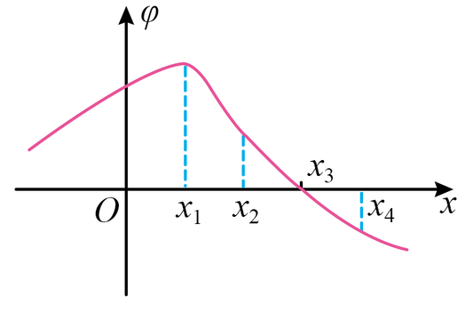

# Physics - 题目 1994

**ID**: 9e852a8efb744188849e90586bd1316e
**年级**: Grade 11
**难度**: Medium-Hard
**题型**: Multiple-choice

## 题目
某空间存在沿x轴的静电场， $x{{}_{1}}$ 、 $x{{}_{2}}$ 、 $x{{}_{3}}$ 、 $x{{}_{4}}$ 是x轴上的四个点，各点的电势 $ϕ$ 随位置的变化情况如图所示。​​​​​​​‌下列说法正确的是（      ）

## 解答

1. A． $φ-x$ 图像的切线斜率表示电场强度， $x{{}_{1}}$ 处为电势的最高点即图像的顶点处，该处的切线斜率为零，即电场强度为零，A正确；
2. B． $x{{}_{3}}$ 点处图像的切线斜率不为零，该点电场强度不为零，则质子在该点处受到的电场力不为零，B错误；
3. C．沿电场方向电势降低，且空间存在沿x轴的静电场，可知 $x{{}_{2}}$ 点处与 $x{{}_{4}}$ 点处沿x轴方向的电场强度的方向相同，均沿x轴正方向，C错误；
4. D．根据 $E{{}_{{\rm{p}}}}=qφ$ ，带负电的粒子在电势低的地方电势能大，电子带负电，从 $x{{}_{1}}$ 到 $x{{}_{4}}$ 电势一直在降低，因此将电子从 $x{{}_{1}}$ 移到 $x{{}_{4}}$ 的过程中，电子的电势能一直在增大，D错误。选A。

## 知识点

**中文**:
  - 静电场中的图像问题

**English**:
  - Graph Problems in Electrostatic Fields

---
