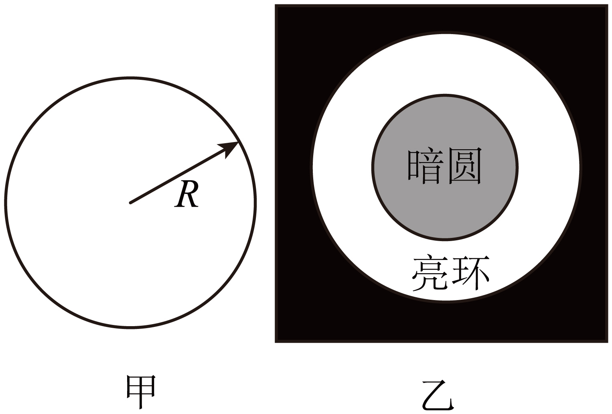

# Physics - 题目 593

**ID**: adee9e79e3864b84aa745accbc215c80
**年级**: Grade 11
**难度**: Medium-Hard
**题型**: Multiple-choice

## 题目
某主题公园的湖里安装了一圆形线状光源的彩灯，半径 $R=5{\rm{m}}$ ，如图甲所示。​​​​​​​‌该光源水平放置到湖水下方，光源圆面与液面平行。当彩灯发出红光时，可在水面正上方观察到如图乙所示的红色亮环，亮环与中间暗圆的面积之比为 $5:4$ ，已知水对红光的折射率为 $\frac {4}{3}$ 。下列说法正确的是（      ）

## 解答

1. 设亮环外边缘与内边缘的半径分别为 $r{{}_{1}}$ 和 $r{{}_{2}}$ ，由题意得 $\frac {πr{{}_{1}^{2}}-πr{{}_{2}^{2}}}{πr{{}_{2}^{2}}}=\frac {5}{4}$ ，求得 $\frac {r{{}_{1}}}{r{{}_{2}}}=\frac {3}{2}$ ，设水对红光的临界角为C，则 $\sin C=\frac {1}{n}=\frac {3}{4}$ ，可得 ${\tan}C=\frac {3}{\sqrt {4{^{2}}-3{^{2}}}}=\frac {3}{7}\sqrt {7}$ ，设光源离水面的垂直距离为h，若光源上的一点射出的光线恰好在水面发生全发射，如图所示
2. 
3. 根据几何关系有 $r{{}_{1}}=R+h{\tan}C$ ， $r{{}_{2}}=R-h{\tan}C$ ，联立得 $h=\frac {\sqrt {7}}{3}{\rm{m}}{\rm ，A}$ 错误；水对蓝光的折射率大于水对红光的折射率，即水对蓝光的临界角小于水对红光的临界角，根据 $r{{}_{2}}=R-h{\tan}C$ ，可知，彩灯变为蓝光时， $r{{}_{2}}$ 增大，即中间暗圆面积增大，B错误；亮环面积与中间暗圆面积之比为 $\frac {πr{{}_{1}^{2}}-πr{{}_{2}^{2}}}{πr{{}_{2}^{2}}}={\left({\frac {r{{}_{1}}}{r{{}_{2}}}}\right)^{2}}-1$ ，若将彩灯上移，即h减小，则 $r{{}_{1}}$ 减小， $r{{}_{2}}$ 增大，所以亮环面积与中间暗圆面积之比减小，C错误；若将光源再向湖底竖直向下移动 $Δh$ ，中间暗圆恰好消失，则 $\left ({h+{\rm{Δ}}h}\right ){\tan}C=R$ ，解得 $\Delta h=\frac {4\sqrt {7}}{3}{\rm{m}}{\rm ，D}$ 正确。

## 知识点

**中文**:
  - 全反射原理及其应用

**English**:
  - Principle and Applications of Total Internal Reflection

---
