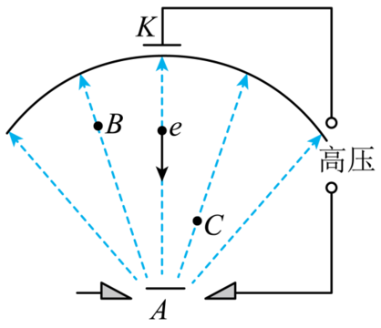

# Physics - 题目 2012

**ID**: b420e2aa1c234af789916b1baa263cd2
**年级**: Grade 11
**难度**: Medium-Hard
**题型**: Multiple-choice

## 题目
如图所示为电子束焊接机，图中带箭头的虚线代表电场线，B、C是电场中两点。​​​​​​​‌K为阴极，A为阳极，两极之间的距离为d，在两极之间加上高压U，有一电子在K极由静止被加速。不考虑电子重力，元电荷为e，则下列说法正确的是（      ）

## 解答

1. A、K之间建立的是非匀强电场，公式 $U=Ed$ 不适用，因此A、K之间的电场强度不等于 $\frac {U}{d}$ ，故A错误；B、C所在等势面为一条条和电场线垂直的圆弧，如图所示
2. 
3. 根据沿电场线方向电势降低，可知B点电势小于C点电势，故B错误；电场线的疏密程度表示电场强度大小，从图中可知B点所在位置的电场线较疏，C点所在位置的电场线较密，故B点的电场强度小于C点的电场强度，故C错误；电子由K到A，受到的电场力方向和电场方向相反，即由K指向A，和运动方向一致，所以电场力做正功，电势能减小，根据动能定理可得 $\left |{\Delta E{{}_{{\rm{p}}}}}\right |=\Delta E{{}_{{\rm{k}}}}=Ue$ ，故D正确。

## 知识点

**中文**:
  - 电势
  - 电场、电场强度
  - 电场线
  - 电势能与静电力做功

**English**:
  - Electric Potential
  - Electric Field and Field Strength
  - Electric Field Lines
  - Electric Potential Energy and Work Done by Electrostatic Force

---
