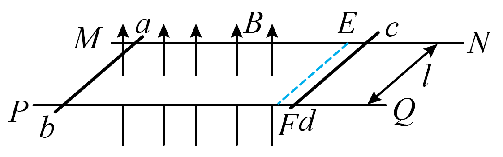

# Physics - 题目 2137

**ID**: b6cb88da86e0414ba718957675825ae1
**年级**: Grade 11
**难度**: Medium-Hard
**题型**: 非选择题：本大题共5题，共56分。

## 题目
如图所示，两根足够长的平行光滑金属导轨MN和PQ水平固定，间距为l，虚线EF左侧有垂直导轨平面向上的匀强磁场，磁感应强度大小为B。​​​​​​​‌两根材料、长度均相同的金属棒ab和cd垂直放置在导轨上，阻值分别为R和4R，ab处于磁场中，cd处于磁场外侧紧靠EF放置（距离不计）。现同时给金属棒ab和cd一个初速度，大小均为v_{0}，方向相反，0时刻cd进入磁场；两金属棒相向运动，但没发生碰撞，t_{1}时刻金属棒ab的电流变为零，此时cd仍在磁场内，t_{2}时刻金属棒ab恰好静止在磁场边界EF处。已知金属棒cd质量为m，导轨电阻不计，运动过程中两金属棒始终与导轨垂直且接触良好，求：（1）0时刻金属棒cd的加速度大小；（2）t_{1}时刻金属棒ab的速度大小及0～t_{l}时间内通过金属棒ab的电荷量；（3）整个过程金属棒ab中产生的焦耳热。

## 解答

1. （1）由题知，0时刻根据右手定则可知，ab棒产生的感应电流方向是a到b，cd棒产生的感应电流方向是d到c，即两个感应电流方向相同，所以回路中感应电动势为两杆产生的感应电动势之和，即 $E=2Blv{{}_{0}}$ ，
2. 回路中感应电流为 $I=\frac {E}{5R}$ ，
3. 因为电阻定律 $R=ρ\frac {l}{S}$ ，
4. 可知 $\frac {S{{}_{ab}}}{S{{}_{cd}}}=\frac {4}{1}$ ，
5. 因为金属棒ab和cd材料、长度均相同，所以可知两棒的质量 $\frac {m{{}_{ab}}}{m{{}_{cd}}}=\frac {4}{1}$ ，
6. 对ab棒，根据牛顿第二定律有 $BIl=4ma{{}_{1}}$ ，
7. 对cd棒，根据牛顿第二定律有 $BIl=ma{{}_{2}}$ ，
8. 解得 $a{{}_{1}}=\frac {B{^{2}}l{^{2}}v{{}_{0}}}{10mR}$ ， $a{{}_{2}}=\frac {2B{^{2}}l{^{2}}v{{}_{0}}}{5mR}$ 。
9. （2）在 $t=t{{}_{1}}$ 时刻，流经ab棒的电流为0，ab和cd的速度相等，整个过程，两棒安培力等大方向，系统动量守恒，根据动量守恒定律有 $4mv{{}_{0}}-mv{{}_{0}}=5mv{{}_{1}}$ ，
10. 可得 $v{{}_{1}}=\frac {3}{5}v{{}_{0}}$ ，方向向右，
11. 对ab棒由动量定理有 $-BIlt=\frac {3}{5}\times 4mv{{}_{0}}-4mv{{}_{0}}$ ，
12. 即 $-Blq=-\frac {8}{5}mv{{}_{0}}$ ，
13. 0～t_{l}时间内通过金属棒ab的电荷量大小 $q=\frac {8mv{{}_{0}}}{5Bl}$ 。
14. （3）整个过程cd棒最终的速度为 $\frac {3}{5}v{{}_{0}}{\rm ，\mathit{ab}}$ 棒静止，两棒损失的机械能转化成两棒的焦耳热，则有 $Q=\frac {1}{2}\times 4mv{{}_{0}^{2}}+\left [\frac {1}{2}\times mv{{}_{0}^{2}}-\frac {1}{2}\times m\times {\left({\frac {3}{5}v{{}_{0}}}\right)^{2}}\right ]=\frac {58}{25}mv{{}_{0}^{2}}$ ，
15. 两棒的电流时刻相等，根据焦耳定律有 $Q{{}_{1}}=I{^{2}}Rt$ ，
16. 可知 $\frac {Q{{}_{ab}}}{Q{{}_{cd}}}=\frac {1}{4}$ ，
17. 所以整个过程金属棒ab中产生的焦耳热 $Q{{}_{ab}}=\frac {58mv{{}_{0}^{2}}}{125}$ 。

## 知识点

**中文**:
  - 双杆模型
  - 导体切割磁感线产生感应电动势（电流）的分析与计算
  - 电磁感应现象中的功能问题

**English**:
  - Double Rod Model
  - Analysis and Calculation of Cutting Magnetic Field Lines
  - Work-Energy Problems in EM Induction

---
