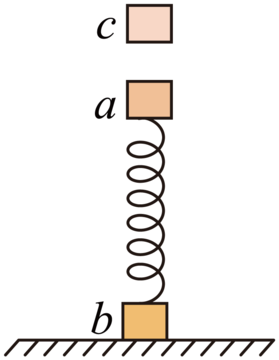

# Physics - 题目 1811

**ID**: c441a2af088e45cfa272d54b91ea8b09
**年级**: Grade 11
**难度**: Medium-Hard
**题型**: Multiple-choice

## 题目
如图所示，质量均为 $m=0.5{\rm{k}}{\rm{g}}$ 的物块a、b用劲度系数为 $k=50{\rm{N}}{\rm{/}}{\rm{m}}$ 的轻弹簧固定拴接，竖直静止在水平地面上。​​​​​​​‌物块a正上方有一个质量也为m的物块c，将c由静止释放，与a碰撞后立即粘在一起，碰撞时间极短，之后在竖直方向做简谐运动。在简谐运动过程中物块b恰好没有脱离地面。忽略空气阻力，轻弹簧足够长且始终在弹性限度内，重力加速度g取 $10{\rm{m}}{\rm{/}}{\rm{s}}{^{2}}$ ，下列说法正确的是（      ）

## 解答

1. A．c和a从相碰后至第一次运动到最低点的过程中弹力先小于重力，加速度向下，随着弹力增大，加速度减少。再弹力大于重力，加速度向上，弹力增大，加速度增大。A错误；
2. C．物体b恰好不脱离地面，所以a、c整体向上到最高点时，弹簧是伸长状态，弹力大小为 $F{{}_{1}}=mg{\rm ，\mathit{a}}$ 、c整体向下运动到最低点时，弹簧是压缩状态，弹力设为 $F{{}_{2}}$ ，碰后a、c整体在竖直方向做简谐运动，最高点、最低点的回复力大小相等，方向相反，则有 $F{{}_{1}}+2mg=F{{}_{2}}-2mg$ ，解得 $F{{}_{2}}=25{\rm{N}}$ ，最低点时，弹簧的弹力最大，所以弹簧的最大弹力为 $25{\rm{N}}$ 。C错误；
3. B．c与a粘合后做简谐运动过程中，两物体在平衡位置时，设弹簧形变量为x，则有 $2mg=kx$ ，设两物体在最低点时，弹簧形变量为 $x^{′}$ ，有 $F{{}_{2}}=kx^{′}$ ，可知振幅为 $A=x^{′}-x=0.3{\rm{m}}{\rm ，B}$ 错误；
4. D．设刚开始释放物块c时，c离a的高度为h，则c与a碰前速度大小为 $v{{}_{0}}=\sqrt {2gh}{\rm ，\mathit{c}}$ 与a碰撞时间极短，由动量守恒定律可得 $mv{{}_{0}}=2mv{{}_{1}}$ ，解得碰后a、c共同速度大小为 $v{{}_{1}}=\frac {1}{2}v{{}_{0}}=\sqrt {\frac {gh}{2}}$ ，从a、c碰后瞬间到反弹至最高点的过程，a、c整体上升的高度为 $h{{}_{1}}=\frac {mg}{k}+\frac {F{{}_{1}}}{k}=0.2{\rm{m}}$ ，对a、c整体由机械能守恒定律可得 $\frac {1}{2}\times 2mv{{}_{1}}{^{2}}=2mgh{{}_{1}}$ ，解得 $h=0.8{\rm{m}}{\rm ，D}$ 正确。选D。

## 知识点

**中文**:
  - 弹簧振子及其运动特点

**English**:
  - Spring Oscillator and Motion Characteristics

---
