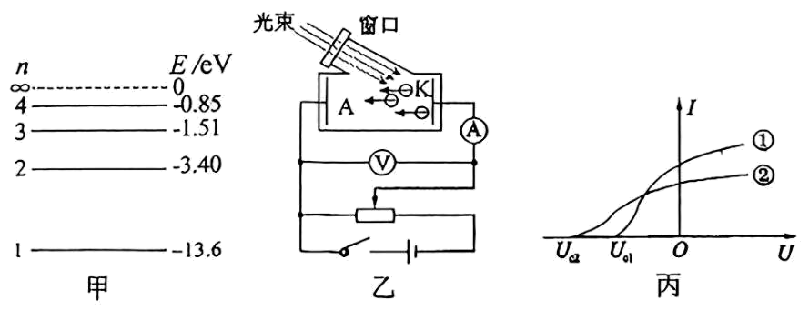

# Physics - 题目 605

**ID**: d71d1030a29b40faaff50be60e1cf3e1
**年级**: Grade 11
**难度**: Medium-Hard
**题型**: Multiple-choice

## 题目
氢原子能级图如甲图所示，大量基态氢原子受激后可辐射出三种不同频率的光，其中有两种能使乙图中逸出功为2.​​​​​​​‌25eV的K极钾金属发生光电效应，通过乙图实验装置得到这两种光分别实验时的电流和电压值，绘出图丙①②两根曲线，则下列说法正确的是（      ）

## 解答

1. 依题意，基态氢原子受激后可辐射出三种不同频率的光的光子能量分别为 $E{{}_{3}}-E{{}_{1}}=12.09eV$ ， $E{{}_{2}}-E{{}_{1}}=10.20eV$ ， $E{{}_{3}}-E{{}_{2}}=1.89eV<2.25eV$ ，显然不能使K极金属产生光电效应的光是从n=3跃迁到n=2时产生的，A错误；乙图中滑动变阻器的滑片向右移动过程中，加在光电管两端的正向电压逐渐增大，电流表示数会增大，但达到饱和电流后，电流表示数将不再增大，B错误；根据 $eU{{}_{c}}=E{{}_{{\rm{k}}}}=hν-W{{}_{逸出功}}$ ，结合图丙可知，图中②曲线对应的入射光光子能量最大，为12.09eV，C正确；丙图中①曲线对应的入射光光子能量为10.20eV，能使钾金属产生光电子的最大初动能为 $E{{}_{km}}=hν-W{{}_{逸出功}}=10.20eV-2.25eV=7.95eV{\rm ，D}$ 错误。

## 知识点

**中文**:
  - 光电效应方程的图像问题
  - 光电效应规律的综合应用
  - 氢原子的能级结构、能级公式和跃迁问题

**English**:
  - Graph Problems of Photoelectric Equation
  - Comprehensive Application of Photoelectric Effect
  - Hydrogen Energy Levels, Formulas, and Transitions

---
