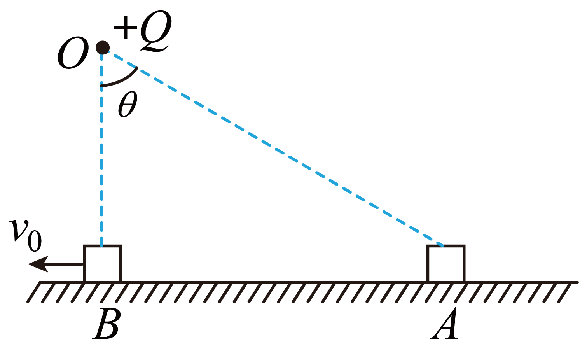

# Physics - 题目 2896

**ID**: df6712bea776431985b9800ca44ce1bd
**年级**: Grade 11
**难度**: Medium-Hard
**题型**: Multiple-choice

## 题目
如图所示，光滑绝缘水平地面上有一点B，在其正上方高h处的O点固定一个电荷量为 $+Q$ 的点电荷。​​​​​​​‌一质量为m、电荷量为 $-q(q>0)$ 的物体（可视为点电荷）从水平地面上的A点静止释放，沿水平地面向B点运动，以速度 $v{{}_{0}}$ 经过B点，图中 $θ=60{}\degree $ 。则下列说法正确的是（      ）

## 解答

1. A．对物体从A点到B点的运动过程，根据动能定理有
2. $-qU{{}_{AB}}=\frac {1}{2}mv{{}_{0}^{2}}$
3. 解得
4. $U{{}_{AB}}=-\frac {mv{{}_{0}^{2}}}{2q}$
5. 故A错误；
6. B．从A点到B点，到O的距离逐渐减小，电势逐渐升高，而物体带负电，所以物体从A点运动到B点的过程中电势能逐渐降低，故B错误；
7. C．根据平衡条件可知物体所受地面的支持力大小为
8. $F{{}_{{\rm{N}}}}=mg-\frac {kQq}{r{^{2}}}{\cos}θ$
9. 物体从A点运动到B点的过程中，r和θ均逐渐减小，所以F_{N}一定逐渐减小，根据牛顿第三定律可知物体对地面的压力逐渐减小，故C错误；
10. D．根据牛顿第二定律有
11. $\frac {kQq}{r{^{2}}}\sin θ=ma$
12. 根据几何关系有
13. $\sin θ=\sqrt {1-{\cos}{^{2}}θ}=\sqrt {1-\frac {h{^{2}}}{r{^{2}}}}$
14. 解得
15. $a=\frac {kQq}{m}\sqrt {\frac {1}{r{^{4}}}-\frac {h{^{2}}}{r{^{6}}}}$
16. 根据数学知识可知，当 $\frac {1}{r{^{2}}}=\frac {2}{3h{^{2}}}$ 时，a有最大值为
17. $a{{}_{{\rm \max }}}=\frac {2\sqrt {3}kQq}{9mh{^{2}}}$
18. 故选D。

## 知识点

**中文**:
  - 带电体在库仑力作用下的运动问题

**English**:
  - Motion under Coulomb Force

---
