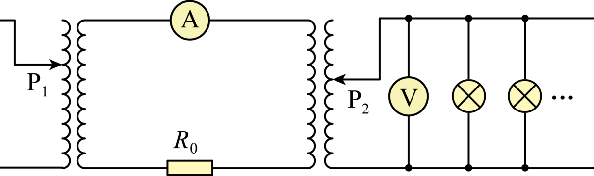

# Physics - 题目 165

**ID**: e12c6a6d118f4ca387f9c85bd42d4eb4
**年级**: Grade 11
**难度**: Medium-Hard
**题型**: Multiple-choice

## 题目
光伏发电，即利用光电效应将太阳能转换成电能的过程，直接输送是最常用的光伏电站输送方式。​​​​​​​‌在光伏电站内部，发电组件通过逆变器将发电组件所产生的直流电信号转换为交流电信号，并提高电压，然后输送到电网上，再经过降压最后输送到用户家中。为探究输电的规律，输送简化电路图如图所示，电路中升压变压器原线圈接电压恒定的交流电源，变压器可视为理想变压器，电表均视为理想电表，电压表示数为U，电流表示数为I，下列说法正确的是（      ）

## 解答

1. ${\rm{P}}{{}_{1}}$ 上调意味着 $n{{}_{1}}$ 变大， $U{{}_{2}}$ 减小， $n{{}_{3}}$ 、 $n{{}_{4}}$ 不变，电流表示数减小，用户总电流就减小，电压表示数也减小。A错误； $n{{}_{1}}$ 、 $n{{}_{2}}$ 不变， $U{{}_{1}}$ 也不变，所以 $U{{}_{2}}$ 也不变，降压变压器和用户等效成电阻 $（\frac {n{{}_{3}}}{n{{}_{4}}}）{^{2}}R{{}_{总}}$ ，现 $R{{}_{总}}$ 减小，电流表示数就增大，用户电压就减小，要使用电器正常工作，就要 ${\rm{P}}{{}_{2}}$ 向上调。B错误；根据理想变压器的规律得 $\frac {n{{}_{3}}}{n{{}_{4}}}=\frac {U{{}_{3}}}{U{{}_{4}}}=\frac {ΔU{{}_{3}}}{ΔU}$ ， $ΔU=\frac {n{{}_{4}}}{n{{}_{3}}}ΔU{{}_{3}}$ ，又 $\frac {ΔU{{}_{3}}}{ΔI}=R{{}_{0}}$ ，即 $\frac {ΔU}{ΔI}=\frac {n{{}_{4}}ΔU{{}_{3}}}{n{{}_{3}}ΔI}=\frac {n{{}_{4}}}{n{{}_{3}}}R{{}_{0}}$ 恒定不变，C正确；电压表测量副线圈电压，若电压表示数不变，则灯的亮度不变，与“夜深了，灯更亮了”矛盾，D错误。

## 知识点

**中文**:
  - 含有理想变压器的动态电路分析
  - 理想变压器原、副线圈两端的电压、功率、电流关系及其应用

**English**:
  - Dynamic Circuit Analysis with Ideal Transformers
  - Voltage, Power, Current Relations in Ideal Transformers

---
