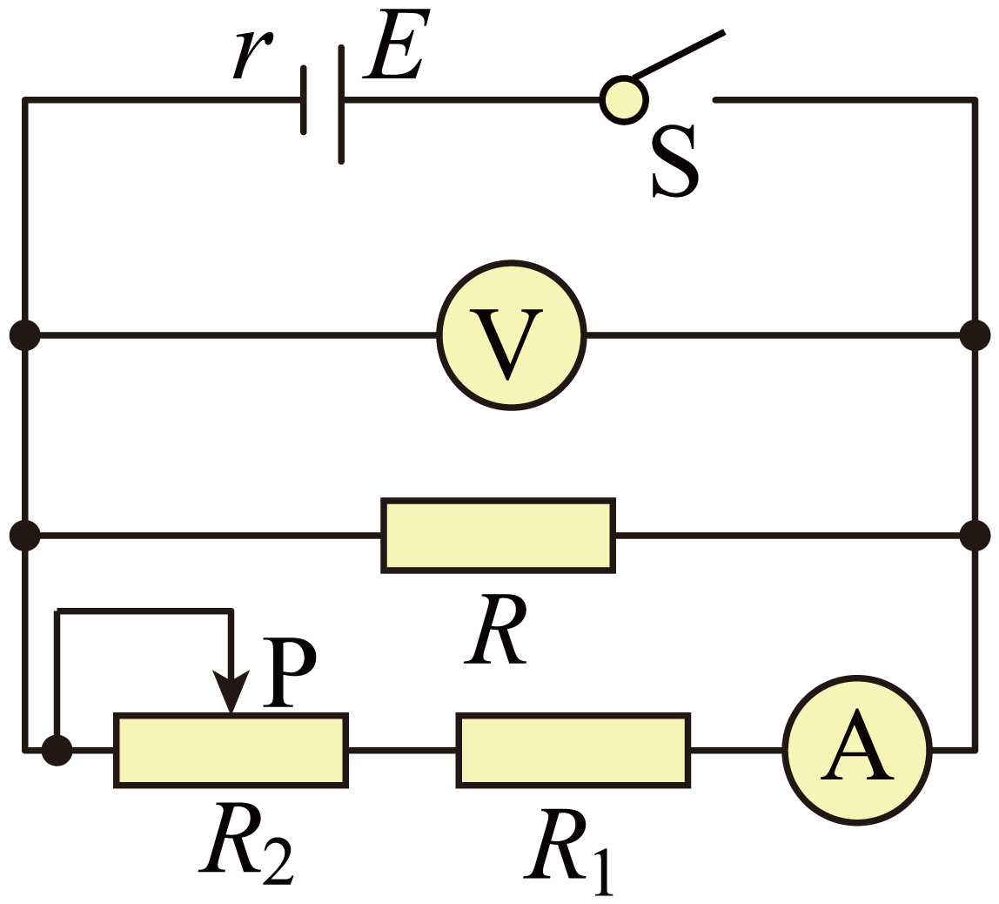

# Physics - 题目 775

**ID**: e2054ddafa53438c93367f5708e7cb0a
**年级**: Grade 11
**难度**: Medium-Hard
**题型**: Multiple-choice

## 题目
如图所示，电源电动势E=6 V，内阻r=1 Ω，定值电阻R=R_{1}=1 Ω，滑动变阻器R_{2}的最大阻值为3 Ω。​​​​​​​‌若闭合开关S，将滑动变阻器的滑片P从右向左滑动，已知两电表均为理想电表，则下列说法正确的是（      ）

## 解答

1. A．若闭合开关S，将滑动变阻器的滑片P从右向左滑动，滑动变阻器接入电路的阻值增大，电路总电阻增大，干路电流减小，内电压减小，路端电压增大，电压表测路端电压，电压表示数增大，因总电流减小，且通过R的电流增大，所以电流表示数减小，A错误；
2. B．当滑动变阻器接入电路的阻值最大时，路端电压最大，定值电阻R上消耗的功率最大，此时外电阻 $R{{}_{外}}{\rm{=}}\frac {R\left ({R{{}_{1}}+R{{}_{2}}}\right )}{R+R{{}_{1}}+R{{}_{2}}}=0.8\Omega $ ，路端电压 $U=\frac {R{{}_{外}}}{r+R{{}_{外}}}E=\frac {8}{3}{\rm V}$ ，所以定值电阻R消耗的功率 $P{{}_{R}}=\frac {U{^{2}}}{R}=\frac {64}{9}{\rm W}{\rm ，B}$ 错误；
3. C．电源的输出功率 $P{{}_{出}}{\rm{=}}\frac {E{^{2}}}{{\left({r+R{{}_{外}}}\right)^{2}}}R{{}_{外}}{\rm{=}}\frac {E{^{2}}}{\frac {r{^{2}}}{R{{}_{外}}}{{+}}R{{}_{外}}{{+}}{{2}}r}$ ，电源的内阻和外电路电阻相等时，电源的输出功率最大，当滑片P从右向左滑动时，外电路的电阻从0.5 Ω增大到0.8 Ω，而电源的内阻为r=1 Ω，所以电源的输出功率一直变大，电源的效率 $η=\frac {UI}{EI}=\frac {U}{E}=\frac {R{{}_{外}}}{R{{}_{外}}{{+}}r}=\frac {1}{1+\frac {r}{R{{}_{外}}}}$ ，电源的效率一定增大，C错误；
4. D．设R_{2}中的电流为I_{1}，R中的电流为I_{2}，则I_{1}（R_{1}+R_{2})=I_{2}R，E=(I_{1}+I_{2}）r+I_{1}（R_{1}+R_{2}），P_{2}= $I{{}_{1}^{2}}{\rm \mathit{R}_{2，}}$ 解得 $P{{}_{2}}={\left({\frac {ER}{R+r}\times \frac {1}{\frac {rR}{R+r}+R{{}_{1}}+R{{}_{2}}}}\right)^{2}}R{{}_{2}}$ ，由此可知，可将电源（E，r）与R看成一个新电源内阻为 $r{^{^{′}}}=\frac {rR}{r+R}$ ，电动势 $E{^{^{′}}}=\frac {ER}{R+r}$ ，滑片P从右向左滑动，当R_{2}=r'+R_{1}=1.5 Ω时，滑动变阻器消耗的功率达到最大值，则滑动变阻器消耗的功率先变大后变小，D正确。选D。

## 知识点

**中文**:
  - 闭合电路输出功率与效率

**English**:
  - Output Power and Efficiency of Closed Circuits

---
