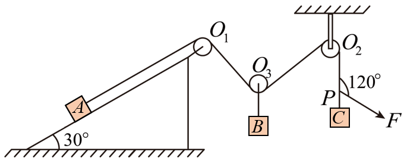

# Physics - 题目 1503

**ID**: e6d6f4e5ab5f4300959794004dd92c68
**年级**: Grade 11
**难度**: Medium-Hard
**题型**: Multiple-choice

## 题目
如图所示，一顶端附有定滑轮O_{1}的斜面体放置在水平地面上，斜面体质量为M、倾角为30°。​​​​​​​‌定滑轮O_{2}通过轻杆固定在天花板上，一细绳绕过两定滑轮O_{1}、O_{2}，一端连接质量为2m的物块A，另一端连接质量为m的物块C，A物块放置在斜面体上，C物块竖直悬挂。另有一动滑轮O_{3}跨在细绳上，下端通过另一细绳连接一质量为m的物块B，整个系统处于静止状态。现在右侧细绳的结点P处施加一与细绳成120°夹角的力F，使物块C缓慢移动，直至右侧细绳O_{2}P处于水平状态。在这个过程中细绳始终拉直，力F的方向始终保持与细绳的夹角不变，物块A和斜面体始终处于静止状态。忽略滑轮的摩擦，在施加力F以后的过程中，下列说法中正确的是（      ）

## 解答

1. A．对结点P受力分析，如图所示
2. 
3. 设O_{2}P与竖直方向的夹角为α，O_{2}P绳上的拉力为T，根据几何关系可得
4. $β=180{}^\circ -120{}^\circ =60{}^\circ $
5. 根据正弦定理可得
6. $\frac {F}{{\sin}α}=\frac {mg}{{\sin}β}=\frac {T}{{\sin}(120{}^\circ -α)}$
7. 当α由0逐渐增大到90°的过程中，sinα逐渐增大，sin（120°-α）先增大后减小，所以F逐渐增大，当O_{2}P水平时，即α=90°时，F达到最大，此时
8. $F=\frac {mg}{{\sin}60{}^\circ }=\frac {2\sqrt {3}}{3}mg$
9. T先增大后减小，当α=30°时，T达到最大，此时
10. $T=\frac {mg}{{\sin}60{}^\circ }=\frac {2\sqrt {3}}{3}mg$
11. 故A错误；
12. B．对滑轮O_{3}与绳的结点受力分析，左右两段绳中的拉力大小相等，均等于T，而连接B物体的绳拉力始终等于mg，设绳与竖直方向的夹角为θ，根据力的合成法有
13. $2T{\cos}θ=mg$
14. 当T先增大后减小的过程中，绳与竖直方向的夹角θ先增大后减小，所以物块B将先向上后向下移动，故B错误；
15. C．对A物体受力分析，初始时重力沿斜面向下的分力与绳的拉力大小相等，所以摩擦力为零，当绳中的拉力先增大后减小的过程中，A所受到的摩擦力方向沿斜面向下，且有
16. $2mg{\sin}30{}^\circ +F{{}_{{\rm{f}}}}=T$
17. 当T先增大后减小的过程中，F_{f}应先增大后减小，故C错误；
18. D．对物块A以及斜面整体为研究对象，地面对斜面体的摩擦力等于O_{1}O_{3}间绳拉力在水平方向的分力，即
19. $f=T{\sin}θ$
20. 当T先增大后减小的过程中，绳与竖直方向的夹角θ先增大后减小，所以f先增大后减小，故D正确。
21. 故选D。

## 知识点

**中文**:
  - 正弦定理在动态平衡中的应用

**English**:
  - Sine Law Method for Dynamic Equilibrium

---
