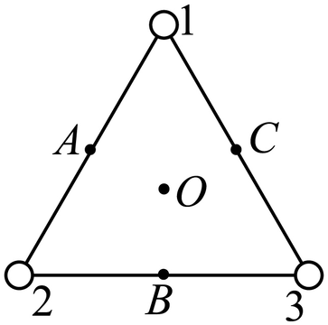

# Physics - 题目 251

**ID**: f862672a54c94454b373b1e7bc7aaff4
**年级**: Grade 11
**难度**: Medium-Hard
**题型**: Multiple-choice

## 题目
单个点电荷 $q$ 周围空间的电势 $φ=k\frac {q}{r}$ ， $r$ 为到点电荷的距离；系统的电势能等于每个电荷电势能总和的一半。​​​​​​​‌现在光滑绝缘水平面上，有三个带电量均为 $+q$ 、质量均为 $m$ 的相同均匀带电小球，用三根长为 $L$ 的轻质绝缘细绳连接，处于静止状态。A、B、C分别为其中点， $O$ 为三角形中心，下列说法正确的是（      ）

## 解答

1. A．O点是正三角形的中心，到各个点的距离都相同，由于各点电荷的电荷量相等，由 $E=\frac {kq}{r{^{2}}}$ ，所以各点电荷在O点产生的场强相同，且两两之间的夹角为 $120{}\degree $ ，由电场叠加原理可得，O点的场强为零。由题意可知点电荷的电势 $φ=\frac {kq}{r}$ ，各点电荷在O点的电势，均相等，由于电势是标量，所以其叠加遵循运算法则，叠加后不为零，A项错误；
2. B．根据点电荷的电场强度有 $E=k\frac {q}{r{^{2}}}$ ，由于各点电荷都是正电荷，所以有电场叠加可知，ABC三点的电场强度大小相等，方向不同，B项错误；
3. C．A点到小球3的距离为 $\frac {\sqrt {3}}{2}L$ ，所以A点的电势为 $φ{{}_{A}}=k\frac {q}{\frac {L}{2}}\cdot 2+k\frac {q}{\frac {\sqrt {3}}{2}L}=\left ({4+\frac {2\sqrt {3}}{3}}\right )k\frac {q}{L}$ ，同理B点的电势为 $φ{{}_{B}}=k\frac {q}{\frac {L}{2}}\cdot 2+k\frac {q}{\frac {\sqrt {3}}{2}L}=\left ({4+\frac {2\sqrt {3}}{3}}\right )k\frac {q}{L}{\rm ，\mathit{C}}$ 点的电势为 $φ{{}_{C}}=k\frac {q}{\frac {L}{2}}\cdot 2+k\frac {q}{\frac {\sqrt {3}}{2}L}=\left ({4+\frac {2\sqrt {3}}{3}}\right )k\frac {q}{L}$ ，所以有 $φ{{}_{A}}=φ{{}_{B}}=φ{{}_{C}}=\left ({4+\frac {2\sqrt {3}}{3}}\right )k\frac {q}{L}{\rm ，C}$ 项错误；
4. D．1电荷的电势能 $E{{}_{{\rm{p}}1}}=\left ({φ{{}_{2}}+φ{{}_{3}}}\right )q=k\frac {2q{^{2}}}{L}$ ，同理可得2和3电荷电势能 $E{{}_{{\rm{p}}2}}=E{{}_{{\rm{p}}3}}=k\frac {2q{^{2}}}{L}$ ，整个系统电势能为 $E{{}_{{\rm{p}}}}=\frac {E{{}_{{\rm{p}}1}}+E{{}_{{\rm{p}}2}}+E{{}_{{\rm{p}}2}}}{2}=k\frac {3q{^{2}}}{L}{\rm ，D}$ 项正确。选D。

## 知识点

**中文**:
  - 电势

**English**:
  - Electric Potential

---
