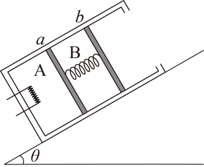

# Physics - 题目 648

**ID**: 02935b049a97498eb0dd26ce06b92910
**年级**: Grade 11
**难度**: Medium-Hard
**题型**: Multiple-select

## 题目
如图所示，固定在倾角θ=30°的斜面上的内壁光滑的绝热汽缸开口处有卡口，汽缸长度为1.2m。​​​​​​​‌活塞a为绝热活塞，活塞b导热性能良好，活塞厚度忽略不计，两活塞用轻质弹簧连接，弹簧的劲度系数k=20N/m。封闭气体A、B初始温度均为T=200K，弹簧恰好处于原长状态，大气压强p_{0}=1×10^{5}Pa，重力加速度g=10m/s^{2}，外界温度保持不变，质量均为2kg、面积均为S=2×10^{－4}m^{2}的活塞a、b将汽缸体积均分为三等份。现给电阻丝通电，缓慢加热密封气体A，下列说法正确的是（      ）

## 解答

1. 对活塞b受力分析，沿斜面方向有 $p{{}_{{\rm{B}}}}S=p{{}_{0}}S+mg\sin θ$ ，可得 $p{{}_{{\rm{B}}}}=p{{}_{0}}+\frac {mg\sin θ}{S}=1.5\times 10{^{5}}{\rm{P}}{\rm{a}}{\rm ，A}$ 正确；在活塞b碰到汽缸卡口之前，将活塞a、b与a、b之间弹簧、气体B看作整体，对整体受力分析，沿斜面方向有 $p{{}_{{\rm{A}}}}S=p{{}_{0}}S+2mg\sin θ$ ，可得 $p{{}_{{\rm{A}}}}=p{{}_{0}}+\frac {2mg\sin θ}{S}=2\times 10{^{5}}{\rm{P}}{\rm{a}}$ ，缓慢加热气体，气体A做等压变化，体积变大，温度升高，气体B的压强不变，体积不变，温度不变，B错误；在活塞b碰到汽缸顶端后，继续加热，弹簧被压缩，气体B发生等温变化，设初状态气体B的体积为 $V{{}_{0}}$ ，当弹簧压缩0.1m时，气体B的体积变为原来的 $\frac {3}{4}$ ，对气体B有 $p{{}_{{\rm{B}}}}V{{}_{0}}=p{{}_{{\rm{B}}}}{^{\prime }}\cdot \frac {3}{4}V{{}_{0}}$ ，解得 $p{{}_{{\rm{B}}}}{^{\prime }}=2\times 10{^{5}}{\rm{P}}{\rm{a}}{\rm ，C}$ 正确；弹簧的弹力 $F=kx=2{\rm{N}}$ ，此时气体A的压强 $p{{}_{{\rm{A}}}}{^{\prime }}=p{{}_{{\rm{B}}}}{^{\prime }}+\frac {mg\sin θ}{S}+\frac {F}{S}=2.6\times 10{^{5}}{\rm{P}}{\rm{a}}$ ，对气体A有 $\frac {p{{}_{{\rm{A}}}}V{{}_{0}}}{T}=\frac {p{{}_{{\rm{A}}}}{^{\prime }}\left ({2V{{}_{0}}+\frac {V{{}_{0}}}{4}}\right )}{T^{′}}$ ，解得 $T^{′}=585{\rm{K}}{\rm ，D}$ 正确。

## 知识点

**中文**:
  - 气体等温变化与玻意耳定律

**English**:
  - Isothermal Change and Boyle's Law

---
