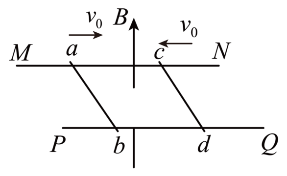

# Physics - 题目 2228

**ID**: 03a730bce255413783377e767857a2ab
**年级**: Grade 11
**难度**: Medium-Hard
**题型**: Multiple-select

## 题目
如图所示，两根足够长的平行金属导轨固定于同一水平面内，导轨间距离为L，导轨上平行放置两根导体棒ab和cd，构成矩形回路，已知ab棒质量为2m，cd棒质量为m，两根导体棒接入电路电阻值均为r，其它电阻忽略不计，整个导轨处于竖直向上的匀强磁场中，磁感应强度为B，导体棒均可沿导轨无摩擦的滑行。​​​​​​​‌开始时两导体棒均静止，现同时给ab一向右的初速度v_{0}，给cd一向左的初速度v_{0}，对之后的整个运动过程（两棒始终没有相碰）下列说法正确的是（      ）

## 解答

1. 对ab，系统受合外力为零，则动量守恒，稳定时的速度为v，向右为正，则根据动量守恒定律，有 $2mv{{}_{0}}-mv{{}_{0}}=3mv$ ，解得 $v=\frac {1}{3}v{{}_{0}}$ ，解得ab棒克服安培力所做的总功为 $W{{}_{ab}}=\frac {1}{2}\cdot 2mv{{}_{0}^{2}}-\frac {1}{2}\cdot 2mv{^{2}}=\frac {8}{9}mv{{}_{0}^{2}}{\rm ，A}$ 正确；对ab，由动量定理有 $-B{\overline{I}}LΔt=-BLq=2mv-2mv{{}_{0}}$ ，解得通过ab棒的电荷量为 $q=\frac {4mv{{}_{0}}}{3BL}{\rm ，B}$ 错误；根据 $q={\overline{I}}Δt=\frac {{\overline{E}}}{2r}Δt=\frac {ΔΦ}{2r}=\frac {BLΔx}{2r}$ ，解得两导体棒间的距离最终缩小了 $Δx=\frac {8mrv{{}_{0}}}{3B{^{2}}L{^{2}}}{\rm ，C}$ 正确；当cd速度为0时，根据动量守恒定律有 $2mv{{}_{0}}-mv{{}_{0}}=2mv{{}_{1}}{\rm ，\mathit{ab}}$ 棒的加速度为 $a=\frac {F{{}_{安}}}{2m}=\frac {BIL}{2m}=\frac {BL\frac {BLv{{}_{1}}}{2r}}{2m}=\frac {B{^{2}}L{^{2}}v{{}_{0}}}{8mr}{\rm ，D}$ 正确。

## 知识点

**中文**:
  - 电磁感应相关的经典模型与问题

**English**:
  - Classic Models and Problems in EM Induction

---
