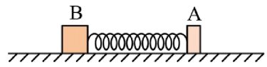

# Physics - 题目 2808

**ID**: 054988a2eac24a23a892517070282dd0
**年级**: Grade 11
**难度**: Medium-Hard
**题型**: Multiple-select

## 题目
如图所示， ${\rm{A}}、{\rm{B}}$ 两物块用一轻弹簧连接放在光滑水平面上，弹簧处于原长。​​​​​​​‌某时刻A以初速度 $v{{}_{0}}$ 向右运动，两物块的质量关系为 $m{{}_{{\rm{B}}}}=2m{{}_{{\rm{A}}}}$ 。在以后的运动过程中，弹簧始终处于弹性限度内， ${\rm{A}}、{\rm{B}}$ 两物块的速度大小 $v{{}_{{\rm{A}}}}、v{{}_{{\rm{B}}}}$ 可能为（      ）

## 解答

1. 由动量守恒定律有 $m{{}_{{\rm{A}}}}v{{}_{0}}=m{{}_{{\rm{A}}}}v{{}_{{\rm{A}}}}+2m{{}_{{\rm{A}}}}v{{}_{{\rm{B}}}}$ ，由能量守恒定律有 $\frac {1}{2}m{{}_{{\rm{A}}}}v{{}_{0}}{^{2}}=\frac {1}{2}m{{}_{{\rm{A}}}}v{{}_{{\rm{A}}}}{^{2}}+\frac {1}{2}\times 2m{{}_{{\rm{A}}}}v{{}_{{\rm{B}}}}{^{2}}+E{{}_{{\rm{p}}}}$ ，则必有 $\frac {1}{2}m{{}_{{\rm{A}}}}v{{}_{{\rm{A}}}}{^{2}}+\frac {1}{2}\times 2m{{}_{{\rm{A}}}}v{{}_{{\rm{B}}}}{^{2}}⩽\frac {1}{2}m{{}_{{\rm{A}}}}v{{}_{0}}{^{2}}$ 当 $v{{}_{{\rm{A}}}}=\frac {1}{3}v{{}_{0}}$ ，根据动量守恒定律，解得 $v{{}_{{\rm{B}}}}=\frac {1}{3}v{{}_{0}}$ ，此时 $\frac {1}{2}m{{}_{{\rm{A}}}}v{{}_{{\rm{A}}}}{^{2}}+\frac {1}{2}\times 2m{{}_{{\rm{A}}}}v{{}_{{\rm{B}}}}{^{2}}<\frac {1}{2}m{{}_{{\rm{A}}}}v{{}_{0}}{^{2}}{\rm ，A}$ 正确；当 $v{{}_{{\rm{A}}}}=2v{{}_{0}}$ ，根据动量守恒定律，解得 $v{{}_{{\rm{B}}}}=-\frac {1}{2}v{{}_{0}}$ ，此时 $\frac {1}{2}m{{}_{{\rm{A}}}}v{{}_{{\rm{A}}}}{^{2}}+\frac {1}{2}\times 2m{{}_{{\rm{A}}}}v{{}_{{\rm{B}}}}{^{2}}>\frac {1}{2}m{{}_{{\rm{A}}}}v{{}_{0}}{^{2}}{\rm ，B}$ 错误；当 $v{{}_{{\rm{B}}}}=\frac {1}{2}v{{}_{0}}$ ，根据动量守恒定律，解得 $v{{}_{{\rm{A}}}}=0$ ，此时 $\frac {1}{2}m{{}_{{\rm{A}}}}v{{}_{{\rm{A}}}}{^{2}}+\frac {1}{2}\times 2m{{}_{{\rm{A}}}}v{{}_{{\rm{B}}}}{^{2}}<\frac {1}{2}m{{}_{{\rm{A}}}}v{{}_{0}}{^{2}}{\rm ，C}$ 正确；当 $v{{}_{{\rm{B}}}}=v{{}_{0}}$ ，根据动量守恒定律，解得 $v{{}_{{\rm{A}}}}=-v{{}_{0}}$ ，此时 $\frac {1}{2}m{{}_{{\rm{A}}}}v{{}_{{\rm{A}}}}{^{2}}+\frac {1}{2}\times 2m{{}_{{\rm{A}}}}v{{}_{{\rm{B}}}}{^{2}}>\frac {1}{2}m{{}_{{\rm{A}}}}v{{}_{0}}{^{2}}{\rm ，D}$ 错误。

## 知识点

**中文**:
  - 动量守恒与弹簧相结合

**English**:
  - Momentum Conservation with Springs

---
