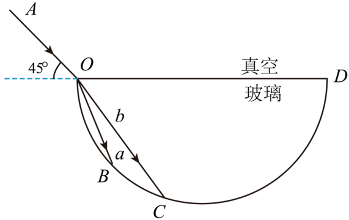

# Physics - 题目 2455

**ID**: 05aa2ef77db443119f175784c36a01c1
**年级**: Grade 11
**难度**: Medium-Hard
**题型**: Multiple-select

## 题目
如图， $OBCD$ 为半圆柱体玻璃的横截面， $OD$ 为直径，一束由紫光和红光组成的复色光沿与 $OD$ 成45°角的 $AO$ 方向从真空射人玻璃，分成 $a$ 、 $b$ 两束单色光，分别传播到分界面的B、C点， $a$ 光由 $O$ 到 $B$ 的传播时间为 $t{{}_{a}}$ ， $b$ 光由 $O$ 到 $C$ 的传播时间为 $t{{}_{b}}$ ，则下列说法正确的是（      ）​​​​​​​‌

## 解答

1. 令折射角为 $θ$ ，作出光路图，如图所示
2. 
3. 根据折射率的定义式有 $n=\frac {\sin 45{^{\circ }}}{{\rm{s}}{\rm{i}}{\rm{n}}θ}$ ，根据几何关系，光在玻璃中传播路程 $s=2R{\rm{s}}{\rm{i}}{\rm{n}}θ$ ，根据折射率与光速的关系有 $n=\frac {c}{v}$ ，光在玻璃中传播时间 $t=\frac {s}{v}=\frac {2R\sin 45{^{\circ }}}{c}$ ，可知，光在玻璃中传播时间与折射角无关，即有 $t{{}_{a}}=t{{}_{b}}{\rm ，A}$ 正确；由于紫光折射率大于红光，根据光路图可知， $a$ 光折射率大于 $b$ 光，则 $a$ 为紫光， $b$ 为红光，B错误；根据临界角与折射率的关系有 $\sin C=\frac {1}{n}$  $a$ 光折射率大于 $b$ 光，可知， $a$ 光的临界角小于 $b$ 光的临界角，结合光路图可知，a光在B点发生全反射，b光在C点不一定发生全反射，C错误；由于b光的频率小于 $a$ 光的频率， $b$ 光照射金属发生光电效应，则 $a$ 光照射该金属时也一定会产生光电效应，D正确。

## 知识点

**中文**:
  - 全反射与折射的综合应用

**English**:
  - Comprehensive Application of Total Reflection and Refraction

---
