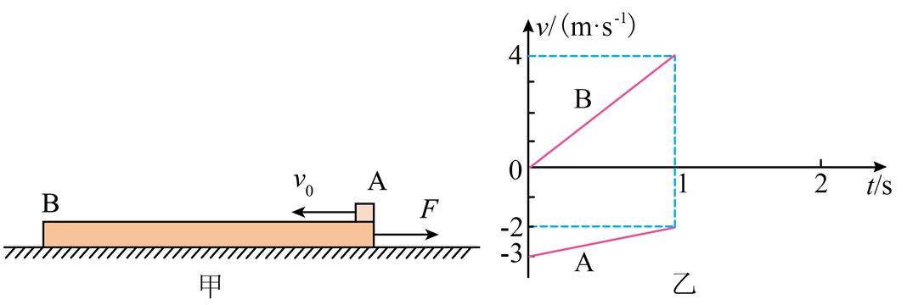

# Physics - 题目 1502

**ID**: 06cfc46339fc46c6877680cde49ade47
**年级**: Grade 11
**难度**: Medium-Hard
**题型**: Multiple-select

## 题目
如图甲所示，滑块A放在静止于水平地面上的木板B右端，已知滑块A与木板B的质量均为 $m=1{\rm{k}}{\rm{g}}，t=0$ 时刻滑块A以 $v{{}_{0}}=3{\rm{m}}/{\rm{s}}$ 的初速度向左运动，同时在木板右端加一个水平向右的外力 $F=9{\rm{N}}$ ，作用 $1{\rm{s}}$ 后撤去外力 $F$ ，前 $1{\rm{s}}$ 内滑块和木板的 $v-t$ 关系图像如图乙所示。​​​​​​​‌设最大静摩擦力等于滑动摩擦力，滑块始终没有离开木板，取重力加速度 $g=10{\rm{m}}/{\rm{s}}{^{2}}$ 。则（      ）

## 解答

1. 前1s内，对滑块A有 $μ{{}_{1}}mg=ma{{}_{1}}$ ，由图中斜率可得 $a{{}_{1}}=1{\rm{m}}/{\rm{s}}{^{2}}$ ，解得滑块和木板间的动摩擦因数 $μ{{}_{1}}=0.1{\rm ，A}$ 正确；前 $1{\rm{s}}$ 内，对木板B有 $F-μ{{}_{1}}mg-μ{{}_{2}}2mg=ma{{}_{2}}$ ，根据图中斜率得 $a{{}_{2}}=4{\rm{m}}/{\rm{s}}{^{2}}$ ，解得木板和地面间的动摩擦因数 $μ{{}_{2}}=0.2{\rm ，B}$ 错误； $1{\rm{s}}$ 后撤去外力 $F$ ，对木板B有 $μ{{}_{1}}mg+μ{{}_{2}}2mg=ma{{}_{3}}$ ，解得 $a{{}_{3}}=5{\rm{m}}/{\rm{s}}{^{2}}$ ，木板B以 $a{{}_{3}}$ 向右做匀减速运动，速度减为零用时 $t=\frac {v{{}_{B}}}{a{{}_{3}}}=0.8{\rm{s}}$ ，由于 $μ{{}_{1}}mg<μ{{}_{2}}2mg$ ，之后木板保持静止，滑块继续向左减速到停；滑块的位移 $x{{}_{1}}=\frac {v{{}_{0}^{2}}}{2a{{}_{1}}}=4.5{\rm{m}}$ ，木板的总位移 $x{{}_{2}}=\frac {1}{2}v{{}_{B}}\left ({t{{}_{1}}+t{{}_{2}}}\right )=\frac {1}{2}\times 4\times \left ({1+0.8}\right ){\rm{m}}=3.6{\rm{m}}$ ，所以木板板长至少为 $L=x{{}_{1}}+x{{}_{2}}=8.1{\rm{m}}{\rm ，C}$ 正确；系统摩擦生热 $Q=μ{{}_{1}}mgL+μ{{}_{2}}2mgx{{}_{2}}=22.5{\rm{J}}{\rm ，D}$ 正确。

## 知识点

**中文**:
  - 功和功率
  - 板块模型

**English**:
  - Work and Power
  - Plate Model

---
