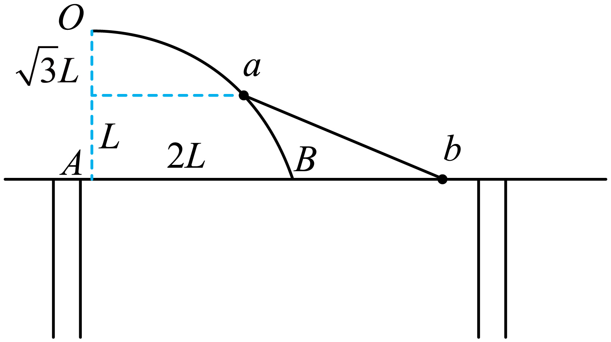

# Physics - 题目 746

**ID**: 073f61c641bb4c02b60ded1925e2d8eb
**年级**: Grade 11
**难度**: Medium-Hard
**题型**: Multiple-select

## 题目
如图，形状为抛物线的光滑导轨固定在竖直面内，O点为抛物线顶点且切线水平，下端B与光滑水平桌面相接触，O点在桌面上投影点为A，OA间高度差为 $\sqrt {3}{\rm \mathit{L}，\mathit{A}}$ 、B两点相距2L，导轨上套有一个小球a，小球a通过长为2L的轻杆与桌面上的小球b相连，小球a、b的质量分别为m和2m，现将小球a从距桌面竖直高度为L处静止释放，则（      ）​​​​​​​‌

## 解答

1. 导轨光滑、桌面光滑，无摩擦力做功。轻杆的弹力属于系统内力，只有重力对系统做功，所以小球a、b组成的系统机械能守恒，A正确；设 $a$ 即将落地时速度与水平方向的夹角为 $α$ ，由于 $a$ 的轨迹为抛物线，根据平抛运动的规律有 ${\rm{t}}{\rm{a}}{\rm{n}}α=2\times \frac {\sqrt {3}L}{2L}=\sqrt {3}$ ，解得 $α=60{^{\circ }}$ ，又因为两球沿杆方向速度相等，则有 $v{{}_{a}}{\rm{c}}{\rm{o}}{\rm{s}}60{^{\circ }}=v{{}_{b}}$ ，解得小球 $a$ 、 $b$ 的速度大小关系为 $v{{}_{a}}=2v{{}_{b}}{\rm ，B}$ 正确；根据系统机械能守恒，小球 $a$ 下落高度 $L$ ，重力势能减少量等于系统动能增加量，即 $mgL=\frac {1}{2}mv{{}_{a}^{2}}+\frac {1}{2}\times 2mv{{}_{b}^{2}}$ ，结合速度关系 $v{{}_{a}}=2v{{}_{b}}$ ，解得 $v{{}_{b}}=\frac {\sqrt {3gL}}{3}{\rm ，C}$ 错误；因为桌面光滑，只有杆弹力对 $b$ 做功，所以小球 $b$ 的机械能增加量，等于轻杆弹力对 $b$ 做的正功。小球 $a$ 克服轻杆弹力做的功，等于轻杆弹力对 $a$ 做的负功的大小。由于系统机械能守恒，小球 $a$ 的机械能减少量等于小球 $b$ 的机械能增加量；而小球 $a$ 的机械能减少量，等于其克服轻杆弹力做的功。因此，小球a克服轻杆弹力做功在数值上等于小球b机械能的增加量，D正确。

## 知识点

**中文**:
  - 求解平抛运动、类平抛运动问题
  - 球杆模型圆周运动中机械能守恒定律的应用

**English**:
  - Solving Horizontal and Quasi-Horizontal Projectile Problems
  - Rod-Ball Circular Motion Models

---
