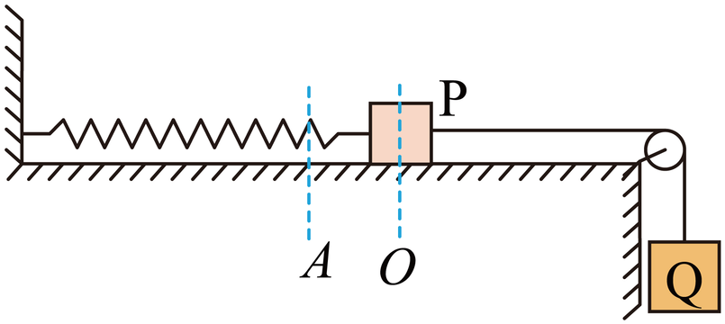

# Physics - 题目 1225

**ID**: 1583d35b94d4408ab917475c946e40c8
**年级**: Grade 11
**难度**: Medium-Hard
**题型**: Multiple-select

## 题目
如图所示，水平光滑桌面上，轻弹簧的左端固定，右端连接物体P，P和Q通过细绳绕过定滑轮连接。​​​​​​​‌开始时，系统处于静止状态，滑块P处于位置O。将滑块P向左推至弹簧原长的位置A点后由静止释放，当滑块P运动到最右端时细绳恰好被拉断，滑块未与定滑轮相碰，弹簧未超出弹性限度，已知Q的质量为m，弹簧的劲度系数为k，重力加速度为g，不计一切摩擦，则（      ）

## 解答

1. 由于物体P、Q组成的系统受到 $F=-kx$ 的回复力，则P、Q组成的系统做简谐运动，位置O为平衡位置，根据对称性可知，当绳断时加速度大小与释放时加速度力小相同，方向相反，A正确；由于滑块P运动到最右端时细绳恰好被拉断，则之后P只受弹力作用，在P往回走的过程中弹力做正功，当滑块P回到 $\mathrm{A}$ 位置时速度最大，B错误；从释放到细绳被拉断过程，根据简谐运动的特点可知，此时动能为0，根据能量守恒定律 $mgh=\frac {1}{2}kh{^{2}}$ ，可得物块Q下落的高度为 $\frac {2mg}{k}{\rm ，C}$ 正确；滑块P运动到最右端时，弹簧弹性势能最大，根据能量关系 $E{{}_{{\rm{p}}}}=\frac {1}{2}kh{^{2}}$ ，可得弹簧的最大弹性势能为 $\frac {2m{^{2}}g{^{2}}}{k}{\rm ，D}$ 错误。

## 知识点

**中文**:
  - 简谐运动的回复力和加速度

**English**:
  - Restoring Force and Acceleration in SHM

---
