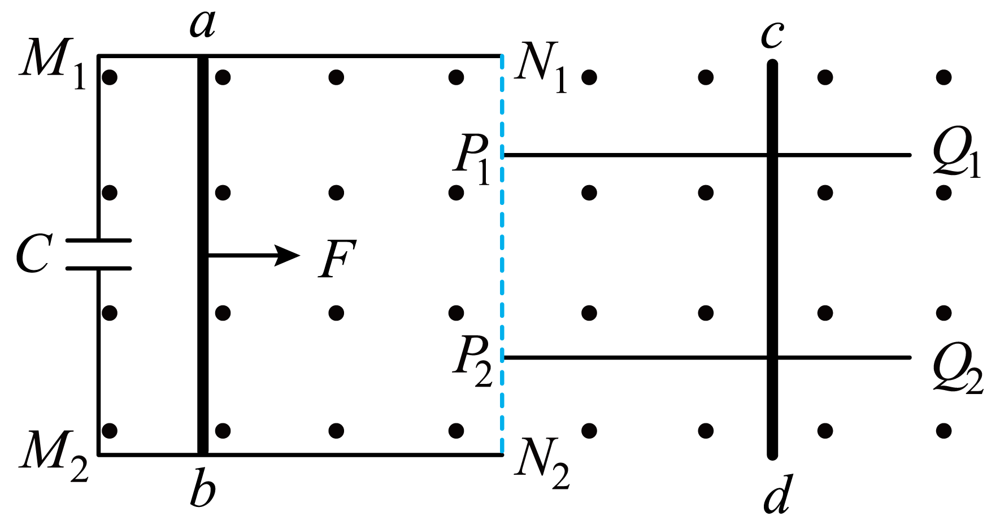

# Physics - 题目 733

**ID**: 19560bff50ee4e0292294dd8acdd6202
**年级**: Grade 11
**难度**: Medium-Hard
**题型**: Multiple-select

## 题目
如图所示，间距为2 m的平行光滑金属导轨 $M{{}_{{{1}}}}N{{}_{{{1}}}}$ 、 $M{{}_{2}}N{{}_{2}}$ 和间距为1 m的平行光滑金属导轨 $P{{}_{1}}Q{{}_{1}}$ 、 $P{{}_{2}}Q{{}_{2}}$ 固定在绝缘水平面上， $N{{}_{1}}$ 、 $P{{}_{1}}$ 、 $P{{}_{2}}$ 和 $N{{}_{2}}$ 四个点在同一直线上， $M{{}_{1}}$ 和 $M{{}_{2}}$ 之间连接一电容为0.1 F的电容器（耐压值足够大），质量均为0.6 kg、长度均为2 m的金属棒ab和cd分别静止在左右导轨上，整个装置处于方向竖直向上、磁感应强度大小为1 T的匀强磁场中。​​​​​​​‌现给ab棒施加一水平向右的恒力 $F=2{\rm{\;}}{\rm{N}}$ ，经过2 s的时间到达 $N{{}_{1}}$ 和 $N{{}_{2}}$ 处，此时立即撤去 $F$ ，金属棒 $ab$ 平滑进入导轨 $P{{}_{1}}Q{{}_{1}}$ 和 $P{{}_{2}}Q{{}_{2}}$ 上。已知金属棒cd接入电路的电阻为1 Ω，其余电阻均不计，整个运动过程中两金属棒未发生碰撞且始终与导轨垂直并接触良好，导轨 $P{{}_{1}}Q{{}_{1}}$ 和 $P{{}_{2}}Q{{}_{2}}$ 足够长。下列说法正确的是（      ）

## 解答

1. 设金属棒 $ab$ 在左导轨上运动时某时刻的速度为 $v$ ，则金属棒 $ab$ 切割磁感线产生的电动势为 $E=BLv$ ，经过 $Δt$ 速度变为 $v^{′}$ ，则 $v^{′}=v+Δv$ ，此时感应电动势为 $E^{′}=BLv^{′}=BL\left ({v+{\rm{Δ}}v}\right )$ ， $Δt$ 时间内流入电容器的电荷量为 ${\rm{Δ}}q=C{\rm{Δ}}U=C\left ({E^{′}-E}\right )=CBL{\rm{Δ}}v$ ，电路中电流 $I=\frac {Δq}{Δt}=\frac {CBLΔv}{Δt}=CBL\frac {Δv}{Δt}=CBLa$ ，所以金属棒ab受到的安培力为 $F{{}_{安}}=BLI=CB{^{2}}L{^{2}}a$ ，对金属棒 $ab$ 列牛顿第二定律方程有 $F-F{{}_{安}}=ma$ ，解得加速度 $a=\frac {F-F{{}_{安}}}{m}=\frac {F}{m+B{^{2}}L{^{2}}C}$ ，代入数据解得 $a=\frac {F}{m+CB{^{2}}L{{}_{1}^{2}}}=2{\rm{\;}}{\rm{m}}{\rm{/}}{\rm{s}}{^{{{2}}}}$ ，所以金属棒 $ab$ 以 $2{\rm{\;}}{\rm{m}}{\rm{/}}{\rm{s}}{^{2}}$ 的加速度做匀加速直线运动。设金属棒ab到达 $N{{}_{1}}$ 和 $N{{}_{2}}$ 处速度为 $v{{}_{0}}$ ，则有 $v{{}_{0}}=at=4{\rm{\;}}{\rm{m}}/{\rm{s}}{\rm ，A}$ 正确；金属棒ab进入导轨 $P{{}_{1}}Q{{}_{1}}$ 和 $P{{}_{2}}Q{{}_{2}}$ 后在安培力的作用下减速运动，金属棒cd在安培力的作用下加速运动，两金属棒组成的系统动量守恒，设最终速度为v，对两金属棒组成的系统，根据动量守恒定律有 $mv{{}_{0}}=2mv$ ，解得 $v=\frac {1}{2}v{{}_{0}}=2{\rm{\;}}{\rm{m}}/{\rm{s}}$ ，对金属棒cd，根据动量定理有 $B{\overline{I}}LΔt=mv$ ，可得通过金属棒cd的电荷量为 $q={\overline{I}}Δt=\frac {mv}{BL}$ ，代入数据解得 $q=1.2{\rm{\;}}{\rm{C}}{\rm ，B}$ 正确；整个过程中减少的动能全部转化为焦耳热，即整个运动过程金属棒cd产生的焦耳热为 $Q=\frac {1}{2}mv{{}_{0}^{2}}-\frac {1}{2}\left ({2m}\right )v{^{2}}=2.4{\rm{\;}}{\rm{J}}{\rm ，C}$ 正确；设金属棒ab在导轨 $P{{}_{1}}Q{{}_{1}}$ 和 $P{{}_{2}}Q{{}_{2}}$ 上做减速运动相对于cd棒的位移为x，则通过金属棒cd的电荷量 $q=\frac {{\rm{Δ}}Φ}{R}=\frac {BL{{}_{2}}x}{R}$ ，代入数据解得 $x=\frac {qR}{BL{{}_{2}}}=1.2{\rm{\;}}{\rm{m}}$ ，所以金属棒ab在导轨 $P{{}_{1}}Q{{}_{1}}$ 和 $P{{}_{2}}Q{{}_{2}}$ 上做变速运动的位移大于1.2 m，D错误。

## 知识点

**中文**:
  - 双杆模型
  - 导体切割磁感线产生感应电动势（电流）的分析与计算
  - 电磁感应现象中的功能问题

**English**:
  - Double Rod Model
  - Analysis and Calculation of Cutting Magnetic Field Lines
  - Work-Energy Problems in EM Induction

---
