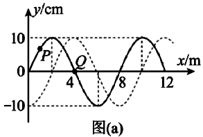
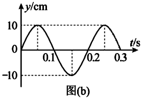

# Physics - 题目 2973

**ID**: 22de4adaaa9e4ad8a3bfbfcadf1d1d17
**年级**: Grade 11
**难度**: Medium-Hard
**题型**: Multiple-select

## 题目
如图（a）所示， $t=0$ 时，一列简谐横波从质点 $O$ （坐标原点）开始沿 $x$ 轴正方向传播，实线和虚线分别为 $t{{}_{1}}$ 时刻和 $t{{}_{2}}$ 时刻的波形图，其中 $t{{}_{2}}>t{{}_{1}}$ ， $P$ ， $Q$ 分别是平衡位置为 $x{{}_{1}}=1.0{\rm{m}}$ 和 $x{{}_{2}}=4.0{\rm{m}}$ 的两质点。​​​​​​​‌图（b）为质点 $O$ 的振动图像，下列说法正确的是（      ）

## 解答

1. $t{{}_{2}}$ 时刻 $Q$ 在波峰位置，加速度最大，选项A错误；这列波的波长8m，周期0.2s，则传播速度为 $v=\frac {λ}{T}=40{\rm{m}}{\rm{/}}{\rm{s}}$ ，选项B正确； $t{{}_{1}}$ 到 $t{{}_{2}}$ 内，质点 $Q$ 运动的时间 $Δt=nT+\frac {T}{4}=(0.2n+0.05){\rm{s}}(n=0，1，2，3.....)$ ，通过的路程可能为 $s=4nA+A=0.1(4n+1){\rm{m}}(n=0、1、2、3.....)$ ，不可能为0.3m，选项C错误；在t=0时刻振源O开始振动，则传到质点P需要的时间为 $t=\frac {x{{}_{1}}}{v}=\frac {1}{40}{\rm{s}}=0.025{\rm{s}}$ ，则 $t=0.125{\rm{s}}$ 时刻质点P振动了0.1s=0.5T可知质点P通过的路程是 $2A=2\times 0.1{\rm{m}}{\rm{=}}{{0}}{{.}}{{2}}{\rm{m}}$ ，选项D正确。

## 知识点

**中文**:
  - 波的多解问题

**English**:
  - Multi-solution Problems in Waves

---
