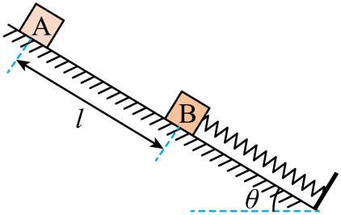

# Physics - 题目 1280

**ID**: 2e0d7c6f876c42fca19b5f9fa13e8e57
**年级**: Grade 11
**难度**: Medium-Hard
**题型**: Multiple-select

## 题目
如图所示，倾角为θ=30°的光滑斜面底端固定一劲度系数为k的轻质弹簧，弹簧上端连接一质量为2m的滑块B且处于静止状态，在B的上方 $l=\frac {9mg}{4k}$ 处由静止释放一质量为m的滑块 A，随后A与B发生碰撞，碰撞时间可忽略不计，碰后A、B一起向下运动，到达最低点后又向上弹回，整个过程中弹力始终未超过弹性限度。​​​​​​​‌已知弹簧振子的周期公式为 $T=2{\rm{π}}\sqrt {\frac {m{{}_{0}}}{k}}$ ，其中k为弹簧的劲度系数，m₀为振子的质量，弹簧形变量为x时弹簧的弹性势能为 $E{{}_{{\rm{p}}}}=\frac {1}{2}kx{^{2}}$ ，重力加速度为g，滑块A、B均可视为质点。下列说法正确的是（      ）

## 解答

1. 设物块A与B碰撞前瞬间的速度为v_{1}，根据机械能守恒定律有 $mgl\sin θ=\frac {1}{2}mv{{}_{1}^{2}}$
2. 解得 $v{{}_{1}}=\frac {3}{2}g\sqrt {\frac {m}{k}}$ ，设碰后瞬间A、B的共同速度为v_{2}，对A、B的碰撞过程，根据动量守恒定律有 $mv{{}_{1}}=3mv{{}_{2}}$ ，解得 $v{{}_{2}}=\frac {1}{3}v{{}_{1}}=\frac {g}{2}\sqrt {\frac {m}{k}}{\rm ，A}$ 错误；初始时刻弹簧的压缩量为 $x{{}_{1}}=\frac {2mg\sin θ}{k}=\frac {mg}{k}$ ，由 $E{{}_{{\rm{p}}}}=\frac {1}{2}kx{^{2}}$ ，设碰后A、B一起向下运动的最大位移为x_{2}，对A、B碰后瞬间到二者到达最低点的过程，根据机械能守恒定律有 $\frac {1}{2}\cdot 3mv{{}_{2}^{2}}+3mgx{{}_{{{2}}}}\sin θ+\frac {1}{2}kx{{}_{1}^{2}}=\frac {1}{2}k(x{{}_{1}}+x{{}_{2}}){^{2}}$ ，解得 $x{{}_{2}}=\frac {3mg}{2k}{\rm ，B}$ 正确；A、B分离的临界条件是二者之间弹力为零且加速度相同，根据牛顿第二定律及整体法分析易知分离瞬间弹簧的形变量应为零，假设A、B碰后的运动过程中未分离，即A、B上升到最高点时弹簧仍处于压缩状态，设此时弹簧的压缩量为x_{3}，根据机械能守恒定律有 $\frac {1}{2}kx{{}_{3}^{2}}+3mg(x{{}_{1}}-x{{}_{3}})\sin θ=\frac {1}{2}kx{{}_{1}^{2}}+\frac {1}{2}\cdot 3mv{{}_{2}^{2}}$ ，解得 $x{{}_{3}}=\frac {mg}{2k}$ ，所以A、B在最高点速度减为零时，弹簧仍处于压缩状态，假设成立，即A、B碰后的运动过程中未分离，C错误；当A、B整体所受合外力为零时，弹簧压缩量为 $x{{}_{4}}=\frac {3mg\sin θ}{k}=\frac {3mg}{2k}$ ，规定该平衡位置为坐标原点O，沿斜面向下为正方向，则当A、B相对O的位移为x时，A、B所受合外力为 $F=3mg\sin θ-k(x{{}_{4}}+x)=-kx$ ，当A、B相对O的位移为－x时，A、B所受合外力为 $F=3mg\sin θ-k(x{{}_{4}}-x)=kx=-k(-x)$ ，由此可判断A、B整体做简谐运动，振幅为 $A=x{{}_{2}}-x{{}_{3}}=\frac {mg}{k}$ ，由题意可知周期为 $T=2{\rm{π}}\sqrt {\frac {3m}{k}}$ ，碰撞时A、B相对平衡位置的位移为 $x=x{{}_{1}}-x{{}_{4}}=-\frac {mg}{2k}=-\frac {A}{2}$ ，如图所示，根据三角函数知识可知，A、B从碰撞到第二次速度减为零所用时间为 $t{{}_{2}}=T-\frac {T}{6}=\frac {5{\rm{π}}}{3}\sqrt {\frac {3m}{k}}{\rm ，D}$ 正确
3. 

## 知识点

**中文**:
  - 弹簧振子及其运动特点

**English**:
  - Spring Oscillator and Motion Characteristics

---
