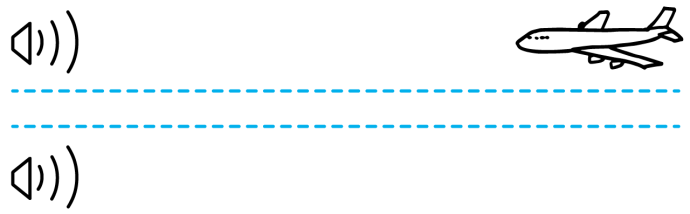

# Physics - 题目 1759

**ID**: 2ee10488177e41c6ae282fc1b48db903
**年级**: Grade 11
**难度**: Medium-Hard
**题型**: Multiple-select

## 题目
物理学原理在现代科技中有许多重要应用。​​​​​​​‌例如，利用波的干涉，可将无线电波的干涉信号用于飞机降落的导航。如图所示，两个可发射无线电波的天线对称地固定于飞机跑道两侧，它们类似于杨氏干涉实验中的双缝。两天线同时都发出波长为 $λ{{}_{1}}$ 和 $λ{{}_{2}}$ 的无线电波。飞机降落过程中，当接收到 $λ{{}_{1}}$ 和 $λ{{}_{2}}$ 的信号都保持最强时，表明飞机已对准跑道。下列说法正确的是（      ）

## 解答

1. 由于两无线电波波源对称分布在跑道两侧，两种波长的无线电波各自发生干涉，在跑道处光程差为零，干涉均加强，两种无线电波各自在空间的强弱分布稳定，但不重合，当接收到的 $λ{{}_{1}}$ 和 $λ{{}_{2}}$ 的信号都保持最强时，表明飞机已对准跑道。干涉要求两波源的频率相同，而强度没有要求，A错误；由于无线电波以光速传播，根据 $v=\frac {c}{λ}$ 知，波长不同，频率不同，所以两种无线电波之间不会发生干涉，B错误；空间中某点加强与减弱取决于到两波源的距离差为半波长的奇、偶数倍。所以两种电波的波峰与波峰叠加最强分布是固定的，而且 $λ{{}_{1}}\ne λ{{}_{2}}$ ，所以无线电波各自在空间的强弱分布不重合，不过中垂线都是加强点，CD正确。

## 知识点

**中文**:
  - 波的加强点与减弱点相关问题

**English**:
  - Constructive and Destructive Interference Points

---
