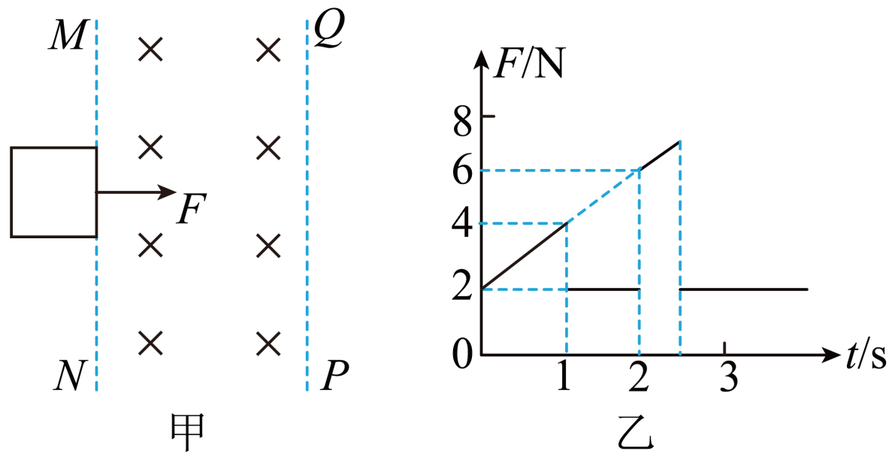

# Physics - 题目 950

**ID**: 31fe377cc6a340388285c34bbc432d71
**年级**: Grade 11
**难度**: Medium-Hard
**题型**: Multiple-select

## 题目
如图甲所示，一正方形单匝金属线框放在光滑水平面上，水平面内两条平行直线MN、OP间存在垂直水平面的匀强磁场， $t=0$ 时，线框在水平向右的外力F作用下紧贴MN从静止开始做匀加速运动，外力F随时间t变化的图线如图乙实线所示，已知线框质量 $m=1{\rm{k}}{\rm{g}}$ 、电阻 $R=2{\rm{Ω}}$ ，则（      ）​​​​​​​‌

## 解答

1. A． $t=0$ 时刻，线框的加速度为 $a=\frac {F}{m}=\frac {2}{1}{\rm{m}}{\rm{/}}{\rm{s}}{^{{{2}}}}=2{\rm{m}}{\rm{/}}{\rm{s}}{^{{{2}}}}$ ，第 $1{\rm{s}}$ 末后直到第 $2{\rm{s}}$ 末这段时间内，拉力 $F$ 恒定为 $F=2{\rm{N}}$ ，此时线框在磁场中不受安培力，磁场宽度 $d=\frac {1}{2}at{{}_{2}^{2}}=\frac {1}{2}\times 2\times 2{^{2}}{\rm{m}}=4{\rm{m}}$ ，故A错误；
2. B．当线框全部进入磁场的瞬间有 $F{{}_{1}}-F{{}_{安}}=ma$ ， $F{{}_{安}}=\frac {B{^{2}}L{^{2}}v}{R}=\frac {B{^{2}}L{^{2}}at{{}_{1}}}{R}$ ，（其中 $F{{}_{1}}=4{\rm{N}}$ ， $t{{}_{1}}=1{\rm{s}})$ ，解得 $B=\sqrt {2}{\rm{T}}$ ，故B正确；
3. C．设线框穿过OP的初末速度分别为 $v{{}_{2}}$ 、 $v{{}_{3}}$ ，线圈全程做匀加速直线运动，则 $v{{}_{2}}=\sqrt {2ad}=4{\rm{m}}{\rm{/}}{\rm{s}}$ ， $v{{}_{3}}=\sqrt {2a(d+L)}=2\sqrt {5}{\rm{m}}{\rm{/}}{\rm{s}}$ ，由动能定理有 $W{{}_{{\rm{F}}}}-W{{}_{F{{}_{安}}}}{\rm{=}}\frac {1}{2}mv{{}_{3}^{2}}-\frac {1}{2}mv{{}_{2}^{2}}$ ，而 $W{{}_{{\rm{F}}{{}_{安}}}}{\rm{=}}Q$ ， $\frac {1}{2}mv{{}_{3}^{2}}-\frac {1}{2}mv{{}_{2}^{2}}=2{\rm{J}}$ ， $W{{}_{{\rm{F}}}}>F{{}_{1}}L=6\times 1=6{\rm{J}}$ ，可得 $Q=W{{}_{F}}-(\frac {1}{2}mv{{}_{3}^{2}}-\frac {1}{2}mv{{}_{2}^{2}})>4{\rm{J}}$ ，即线框穿过OP的过程中产生的焦耳热大于4J，C错误；
4. D．设线框的边长为 $L$ ，则进磁场的过程从0~1s的位移为 $L=\frac {1}{2}at{{}_{1}^{2}}=1{\rm{m}}$ ，线框穿过MN的过程中通过导线内某一横截面的电荷量为 $q={\overline{I}}\cdot Δt=\frac {Δϕ}{Δt\cdot R}\times Δt=\frac {BL{^{2}}}{R}=\frac {\sqrt {2}\times 1{^{2}}}{2}{\rm{C}}=\frac {\sqrt {2}}{2}{\rm{C}}$ ，故D正确；选BD。

## 知识点

**中文**:
  - 电磁感应定律中的图像问题
  - 线框模型
  - 电磁感应现象中的功能问题

**English**:
  - Graph Problems in EM Induction
  - Wire Frame Model
  - Work-Energy Problems in EM Induction

---
