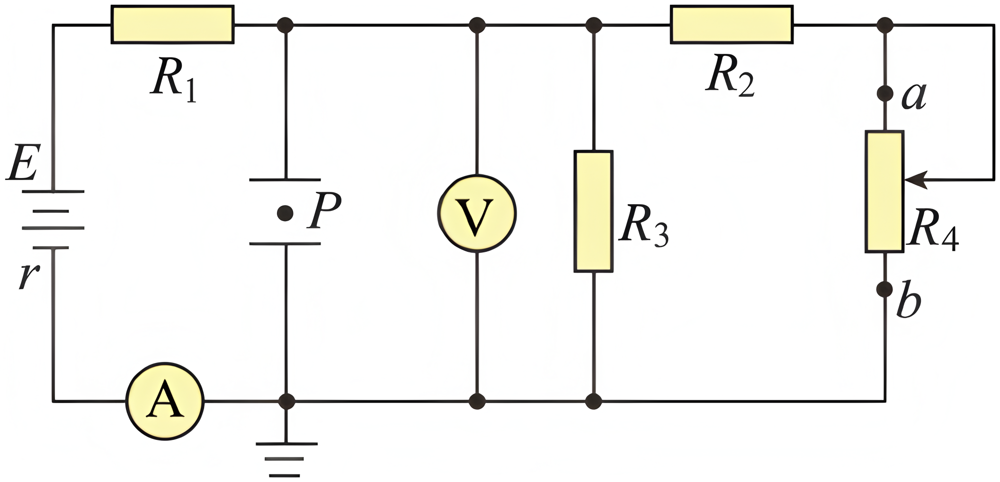

# Physics - 题目 889

**ID**: 3b1357c61c104266b429fbed6244bb24
**年级**: Grade 11
**难度**: Medium-Hard
**题型**: Multiple-select

## 题目
如图所示电路中，电源电动势为E，内阻为r，平行金属板中有一个带电油滴悬浮在两板间的P点。​​​​​​​‌不考虑电流表和电压表对电路的影响，选地面的电势为零。当滑动变阻器 $R{{}_{4}}$ 的滑片向a端移动时，下列说法正确的是（      ）

## 解答

1. AB．油滴原来静止在电容器内，受向上的电场力与向下的重力且二力平衡，由题图可知，电容器内部电场方向向下，所以油滴带负电。当滑片向a移动时，滑动变阻器接入电路的电阻增大，则电路中总电阻增大，由闭合电路欧姆定律可知，电路中的电流减小，所以 $R{{}_{1}}$ 两端的电压和内阻 $r$ 的电压均减小，则电压表的示数增大，而电容器的电压等于电压表的示数也增大，电容器内场强增大，油滴所受电场力大于重力，将向上运动，A错误，B正确；
2. C．电源的效率为
3. $η=\frac {R}{R+r}\times 100\%=\frac {1}{1+\frac {r}{R}}\times 100\%$
4. 当滑动变阻器 $R{{}_{4}}$ 的滑片向a端移动时，其阻值增大，外电阻R增大，电源的效率变大，C错误；
5. D．将 $R{{}_{1}}$ 和电源等效为一个新的电源，新电源的内阻为 $r+R{{}_{1}}$ ，电压表测的为新电源的路端电压，电流表测的是总电流，有
6. $E=U+I(R{{}_{1}}+r)$
7. 可得
8. $\frac {\left |{{\rm{Δ}}U}\right |}{\left |{{\rm{Δ}}I}\right |}=r+R{{}_{1}}$
9. D正确。
10. 选BD。

## 知识点

**中文**:
  - 闭合电路输出功率与效率

**English**:
  - Output Power and Efficiency of Closed Circuits

---
