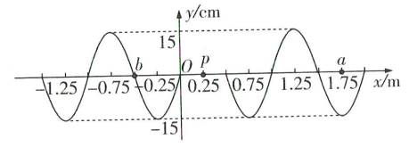

# Physics - 题目 1311

**ID**: 494881d534344a3c9df1eea205f24419
**年级**: Grade 11
**难度**: Medium-Hard
**题型**: Multiple-select

## 题目
位于 $x=0.25{\rm{m}}$ 的波源 $p$ 从 $t=0$ 时刻开始振动,形成的简谐横波沿 $x$ 轴正负方向传播,在 $t=2.0{\rm{s}}$ 时波源停止振动, $t=2.1{\rm{s}}$ 时的部分波形如图所示,其中质点 $a$ 的平衡位置 $x{{}_{a}}=1.75{\rm{m}}$ ,质点 $b$ 的平衡位置 $x{{}_{b}}=-0.5{\rm{m}}$ 。​​​​​​​‌下列说法正确的是（      ）

## 解答

1. 

## 知识点

**中文**:
  - 波的图像及其应用

**English**:
  - Wave Graphs and Applications

---
