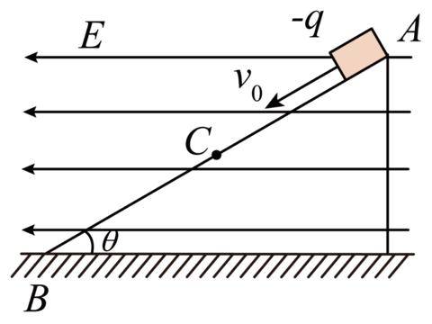

# Physics - 题目 68

**ID**: 4c47a421de524ff590f8df44ab3952f4
**年级**: Grade 11
**难度**: Medium-Hard
**题型**: Multiple-select

## 题目
如图所示，在水平向左的匀强电场中，可视为质点的带负电物块，以某一初速度（大小未知）从足够长的绝缘斜面上的 $A$ 点，沿斜面向下运动，经 $C$ 点到达 $B$ 点（在斜面上）时，速度减为零，然后再返回到 $A$ 点。​​​​​​​‌已知斜面倾角 $θ=30{^{\circ }}$ ，物块与斜面间的动摩擦因数 $μ=\frac {\sqrt {3}}{3}$ ，整个过程斜面均保持静止，物块所带电荷量不变，则以下说法正确的是（      ）

## 解答

1. 在物块下滑过程中，若无电场力，由于斜面对物体的支持力为N=mgcos30°，摩擦力f=μmgcos30°=mgsin30°，可知支持力和摩擦力的合力方向竖直向上；当加电场力后N=mgcos30°+qEsin30°，f=μ(mgcos30°+qEsin30°)，支持力和摩擦力成比例关系增加，则摩擦力和支持力的合力仍竖直向上，根据牛顿第三定律，则物块给斜面的摩擦力和压力的方向竖直向下，可知斜面在水平方向受力为零，则斜面所受地面的摩擦力为零，A错误；在物块上滑过程中，物块受到的重力、电场力不变，斜面对物块的支持力不变，斜面对物块的摩擦力方向沿斜面向下。由牛顿第三定律，物块对斜面的压力和摩擦力方向分别为垂直斜面指向右下方和沿斜面向上，两力都有水平向右的分量，根据平衡条件可知地面对斜面体的摩擦力方向向左，B正确；设斜面长度为 $L$ ，物块在下滑过程中机械能的减少量等于除重力以外克服电场力和摩擦力做的功，即 $ΔE{{}_{1}}=qEL\cdot {\cos}θ+μ(mg{\rm{c}}{\rm{o}}{\rm{s}}30{}\degree +qE{\rm{s}}{\rm{i}}{\rm{n}}30{}\degree )\cdot L$ ，物块在上滑过程中机械能的增加量等于除重力以外电场力和克服摩擦力做的功，即 $ΔE{{}_{2}}=qEL\cdot {\cos}θ-μ(mg{\rm{c}}{\rm{o}}{\rm{s}}30{}\degree +qE{\rm{s}}{\rm{i}}{\rm{n}}30{}\degree )\cdot L$ ，由 $ΔE{{}_{1}}>ΔE{{}_{2}}$ ，物块在下滑过程中机械能的减少量大于物块在上滑过程中机械能的增加量，C正确；在物块下滑过程中摩擦产生热量 $Q{{}_{1}}=μ(mg{\rm{c}}{\rm{o}}{\rm{s}}30{}\degree +qE{\rm{s}}{\rm{i}}{\rm{n}}30{}\degree )\cdot L$ ，在物块上滑过程中摩擦产生热量 $Q{{}_{2}}=μ(mg{\rm{c}}{\rm{o}}{\rm{s}}30{}\degree +qE{\rm{s}}{\rm{i}}{\rm{n}}30{}\degree )\cdot L$ ，在物块下滑过程中摩擦产生热量等于在物块上滑过程中摩擦产生热量，D错误。

## 知识点

**中文**:
  - 功能关系与能量守恒定律的综合应用
  - 受力分析

**English**:
  - Comprehensive Applications of Work-Energy Relation and Energy Conservation
  - Force Analysis

---
