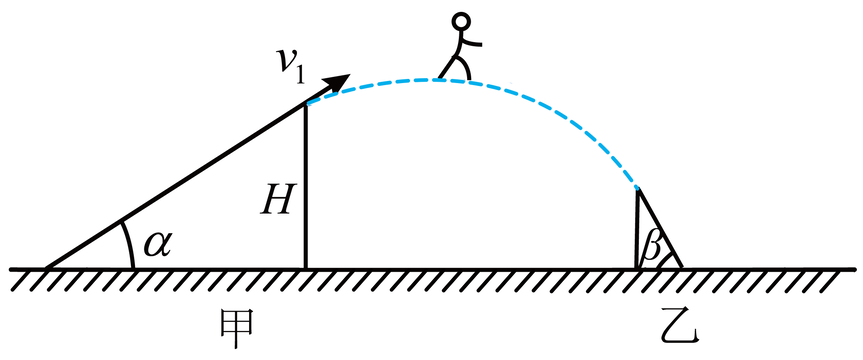

# Physics - 题目 2119

**ID**: 4f93b868943846db8a8a0a2acf45a058
**年级**: Grade 11
**难度**: Medium-Hard
**题型**: Multiple-select

## 题目
图示为某滑雪运动员训练的场景，运动员以速度v_{1}＝10m/s沿倾角α＝37°、高H＝15m的斜面甲飞出，并能无碰撞地落在倾角β＝60°的斜面乙上，顺利完成飞越。​​​​​​​‌把运动员视为质点，忽略空气阻力，重力加速度取g＝10m/s^{2}，sin37°＝0.6，cos37°＝0.8。以下说法正确的是（      ）

## 解答

1. 将速度 $v{{}_{1}}$ 沿水平和竖直方向分解，可得 $v{{}_{x}}=v{{}_{1}}{\cos}37{}\degree =8{\rm{m}}/{\rm{s}}$ ， $v{{}_{y}}=v{{}_{1}}\sin 37{}\degree =6{\rm{m}}/{\rm{s}}$ ，运动员恰能无碰撞地落在斜面乙顶端，说明运动员此时的速度方向恰好沿着斜面乙向下，设为 $v{{}_{2}}$ ，将 $v{{}_{2}}$ 沿水平和竖直方向分解，有 $v{{}_{2}}{\cos}β=v{{}_{x}}=8{\rm{m}}/{\rm{s}}$ ， $v^{′}{{{}_{y}}}=v{{}_{2}}\sin β$ ，解得 $v{{}_{2}}=16{\rm{m}}/{\rm{s}}$ ， $v^{′}{{{}_{y}}}=8\sqrt {3}{\rm{m}}/{\rm{s}}{\rm ，A}$ 正确；设斜面乙的高度为 $h$ ，对运动员从斜面甲运动到斜面乙的过程分析，由动能定理得 $mg(H-h)=\frac {1}{2}mv{{}_{2}^{2}}-\frac {1}{2}mv{{}_{1}^{2}}$ ，解得 $h=7.2{\rm{m}}{\rm ，B}$ 正确；当运动员竖直方向的速度减为零时，距离地面的最大高度为 $h{{}_{{\rm \max }}}=H+\frac {v{{}_{y}^{2}}}{2g}=16.8{\rm{m}}{\rm ，C}$ 错误；设运动员在空中运动的时间为t，由竖直方向运动规律得 $t=\frac {v{{}_{y}}+v^{′}{{{}_{y}}}}{g}=\frac {3+4\sqrt {3}}{5}{\rm{s}}$ ，由水平方向运动规律得 $x=v{{}_{x}}t=\frac {8(3+4\sqrt {3})}{5}{\rm{m}}\approx {{1}}{{5}}{{.}}{{9}}{\rm{m}}{\rm ，D}$ 错误。

## 知识点

**中文**:
  - 斜抛运动

**English**:
  - Oblique Projectile Motion

---
