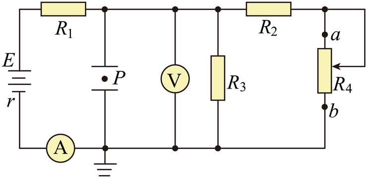

# Physics - 题目 2273

**ID**: 59734f6acd3c4d71a150199e85905887
**年级**: Grade 11
**难度**: Medium-Hard
**题型**: Multiple-select

## 题目
如图所示，平行金属板中带电质点P处于静止状态，不考虑电流表和电压表对电路的影响，选地面的电势为零，当滑动变阻器R_{4}的滑片向b端移动时，下列说法正确的是（      ）​​​​​​​‌

## 解答

1. A．滑动变阻器R_{4}的滑片向b端移动时，接入电阻减小，外电路总电阻减小，干路电流增大，根据
2. $U=E-I\left ({r+R{{}_{1}}}\right )$
3. 可知，电压表的示数减小，A正确；
4. B．电压表示数减小，即平行金属板之间的电压减小，根据
5. $E^{′}=\frac {U}{d}$
6. 金属板之间的电场强度减小，由于带电质点P先前处于静止状态，重力与电场力平衡，电场力方向向上，当电场强度减小时，电场力减小，质点向下运动，电场力做负功，电势能增大，B错误；
7. C．由于
8. $η=\frac {I{^{2}}R{{}_{外}}}{I{^{2}}\left ({R{{}_{外}}+r}\right )}=\frac {1}{1+\frac {r}{R{{}_{外}}}}$
9. 滑片向b端移动时，接入电阻减小，外电路总电阻减小，可知，电源的效率变低，C错误；
10. D．根据上述有
11. $U=E-I\left ({r+R{{}_{1}}}\right )$
12. 解得
13. $\frac {ΔU}{ΔI}=r+R{{}_{1}}$
14. D正确。
15. 选AD。

## 知识点

**中文**:
  - 电路的动态分析问题

**English**:
  - Dynamic Circuit Analysis

---
