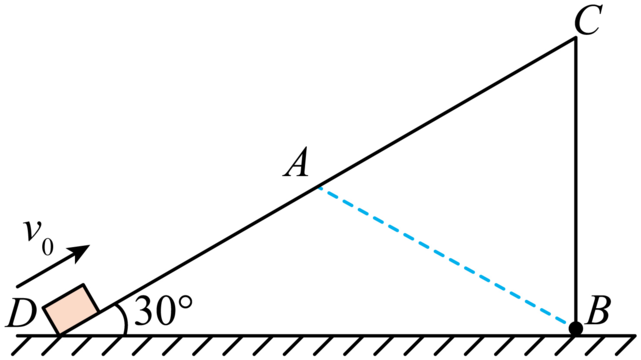

# Physics - 题目 1444

**ID**: 59f2d94a29134a0fa0fde75d2f855cee
**年级**: Grade 11
**难度**: Medium-Hard
**题型**: Multiple-select

## 题目
如图所示，长度为 $2L$ 、倾角为 $30{}\degree $ 的光滑绝缘斜面 $BCD$ 固定在水平面上，电量为 $+q$ 的小球固定在 $B$ 点。​​​​​​​‌质量为 $m$ 、电量为 $+q$ 的小滑块从斜面底端 $D$ 点以初速度 $v{{}_{0}}$ 滑上斜面，刚好能沿斜面运动到顶点 $C$ 。已知 $\mathrm{A}$ 为 $DC$ 的中点， $\angle DBC=90{}\degree $ ，重力加速度为 $g$ ，静电力常量为 $k$ ，下列说法正确的是（      ）

## 解答

1. 根据点电荷周围的电场分布情况可知，小滑块上滑的过程中，电场力对滑块先做负功，后做正功，A错误；小滑块在 $\mathrm{A}$ 点时，由库仑定律可得滑块受到的电场力 $F=\frac {kq{^{2}}}{L{^{2}}}$ ，对滑块受力分析如图所示
2. 
3. 将重力和电场力沿斜面方向进行分解，根据牛顿第二定律可得 $mg\sin 30{}\degree +\frac {kq{^{2}}}{L{^{2}}}{\cos}60{}\degree =ma$ ，解得 $a=\frac {1}{2}g+\frac {kq{^{2}}}{2{\rm mL}{^{2}}}{\rm ，B}$ 正确；设滑块从D到C的过程中，电场力所做的功为 $W$ ，动能定理可得 $-mg\centerdot 2L\sin 30{}\degree +W=0-\frac {1}{2}mv{{}_{0}^{2}}$ ，解得 $W=mgL-\frac {1}{2}mv{{}_{0}^{2}}$ ，根据电场分布特点可知，D到A与D到C电场力所做的功相等，则从D到A由动能定理可得 $-mgL\sin 30{}\degree +W=\frac {1}{2}mv{{}_{A}^{2}}-\frac {1}{2}mv{{}_{0}^{2}}$ ，解得 $v{{}_{A}}=\sqrt {gL}{\rm ，C}$ 正确；根据动能定理可得 $-mgL\sin 30{}\degree +qU{{}_{DA}}=\frac {1}{2}mv{{}_{A}^{2}}-\frac {1}{2}mv{{}_{0}^{2}}$ ，其中 $v{{}_{A}}=\sqrt {gL}$ ，联立解得 $U{{}_{DA}}=\frac {2mgL-mv{{}_{0}^{2}}}{2q}{\rm ，D}$ 正确。

## 知识点

**中文**:
  - 带电粒子在点电荷电场中的运动
  - 应用动能定理求解多阶段、多过程问题

**English**:
  - Motion in Point Charge Field
  - Multi-stage/Multi-process Problems

---
