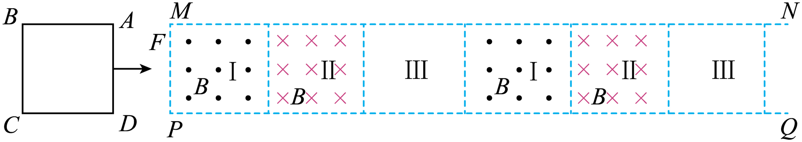

# Physics - 题目 212

**ID**: 5ac3ef3ba0af4e7f9b33a08b910a22f1
**年级**: Grade 11
**难度**: Medium-Hard
**题型**: Multiple-select

## 题目
匝数为N的正方形金属线框ABCD放在光滑水平面上，它的边长为L，质量为m，电阻为R。​​​​​​​‌如图所示，在其右侧有垂直于水平面的磁场，磁场区域边界MN、PQ平行，相距为L，区域Ⅰ、Ⅱ、Ⅲ的宽度都为L，其中区域Ⅲ中无磁场，区域Ⅰ、Ⅱ中存在方向相反、磁感应强度大小均为B的匀强磁场。若干个这样的区域Ⅰ、Ⅱ、Ⅲ依次排列。线框在水平外力F的作用下始终向右以 $v{{}_{0}}$ 匀速运动，将AD边刚进入区域Ⅰ时作为计时起点，感应电流以顺时针方向为正方向，以水平向右为力的正方向。则以下图像正确的是（      ）

## 解答

1. 当正方形线框的AD边进入区域Ⅰ中时，由楞次定律可得电流方向为顺时针方向，与规定的正方向相同，AD边切割磁感线产生的电动势大小 $E=NBLv{{}_{0}}$ ，电流大小为 $I=\frac {NBLv{{}_{0}}}{R}$ ，线框所受安培力大小 $F{{}_{安}}=\frac {N{^{2}}B{^{2}}L{^{2}}v{{}_{0}}}{R}$ ，由左手定则可知方向向左，外力与安培力平衡，等大反向；当线框从区域Ⅱ进入区域Ⅲ的过程中，电流方向、电流大小和线框所受安培力的大小、方向均与进入区域Ⅰ相同；当线框从区域Ⅰ进入区域Ⅱ的过程中，AD边在Ⅱ中切割磁感线，BC边在Ⅰ中切割磁感线，线框产生的电流方向为逆时针方向，与规定的正方向相反，电动势 $E{{}_{1}}=2NBLv{{}_{0}}$ ，电流大小为 $I{{}_{1}}=\frac {2NBLv{{}_{0}}}{R}$ ，线框左右两边都受向左的安培力，安培力大小为 $F{{}_{安{{1}}}}{\rm{=}}\frac {4N{^{2}}B{^{2}}L{^{2}}v{{}_{0}}}{R}$ ，拉力与之等大反向。故BD正确，AC错误。

## 知识点

**中文**:
  - 电磁感应定律中的图像问题
  - 线框模型

**English**:
  - Graph Problems in EM Induction
  - Wire Frame Model

---
