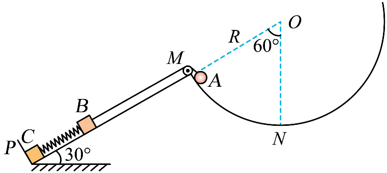

# Physics - 题目 2320

**ID**: 60c3dc3ec6d34437a5f074258f41470a
**年级**: Grade 11
**难度**: Medium-Hard
**题型**: Multiple-select

## 题目
如图所示，挡板P固定在倾角为 $30{^{\circ }}$ 的斜面左下端，斜面右上端M与半径为R的圆弧轨道MN连接其圆心O在斜面的延长线上。​​​​​​​‌M点有一光滑轻质小滑轮， $\angle MON=60{^{\circ }}$ 。质量均为m的小物块B、C由一轻质弹簧拴接（弹簧平行于斜面），其中物块C紧靠在挡板P处，物块B用跨过滑轮的轻质细绳与一质量为4m、大小可忽略的小球A相连，初始时刻小球A锁定在M点，细绳与斜面平行，且恰好绷直而无张力，B、C处于静止状态。某时刻解除对小球A的锁定，当小球A沿圆弧运动到最低点N时（物块B未到达M点），物块C对挡板的作用力恰好为0。已知重力加速度为g，不计一切摩擦，下列说法正确的是（      ）

## 解答

1. A．设弹簧的劲度系数为k，初始时刻弹簧的压缩长度为 $x{{}_{1}}$ ，则B沿斜面方向受力平衡，则 $mg\sin 30{}\degree =kx{{}_{1}}$ ，小球A沿圆弧运动到最低点N时，物块C即将离开挡板时，设弹簧的拉伸长度为 $x{{}_{2}}$ ，则C沿斜面方向受力平衡，则 $mg\sin 30{}\degree =kx{{}_{2}}$ ，易得 $x{{}_{1}}=x{{}_{2}}$ ，当小球A沿圆弧运动到最低点N时，B沿斜面运动的位移为 $s{{}_{B}}=x{{}_{MN}}=R$ ，所以 $x{{}_{1}}+x{{}_{2}}=R$ ，解得 $x{{}_{1}}=x{{}_{2}}=\frac {R}{2}$ ， $k=\frac {mg}{R}{\rm ，A}$ 错误；
2. BC．设小球A到达N点时的速度为 $v$ ，对 $v$ 进行分解，在沿绳子方向的速度 $v^{′}=v{\cos}30{}\degree $ ，由于沿绳子方向的速度处处相等，所以此时B的速度也为 $v^{′}$ ，对A、B、C和弹簧组成的系统，在整个过程中，只有重力和弹簧弹力做功，且A在M和N处，弹簧的形变量相同，弹性势能不变，弹簧弹力做功为0，重力对A做正功，对B做负功，A、B、C和弹簧组成的系统机械能守恒，可知 $4mgR(1-{\cos}60{}\degree )-mg(x{{}_{1}}+x{{}_{2}})\sin 30{}\degree =\frac {1}{2}\cdot 4mv{^{2}}+\frac {1}{2}mv^{′}{{^{2}}}$ ，解得 $v=\sqrt {\frac {12}{19}gR}{\rm ，B}$ 正确，C错误；
3. D．小球A由M运动到N的过程中，A、B、C和弹簧组成的系统机械能守恒，则小球A和物块B的机械能之和与弹簧和C的能量之和不变，C一直处于静止状态，弹簧一开始处于压缩状态，之后变为原长，后开始拉伸，则弹性势能先减小后增大，小球A和物块B的机械能之和先增大后减小，D正确。选BD。

## 知识点

**中文**:
  - 其他连接体问题中机械能守恒定律的应用
  - 弹簧问题中机械能守恒定律的应用

**English**:
  - Other Connected Body Problems
  - Spring Problems

---
