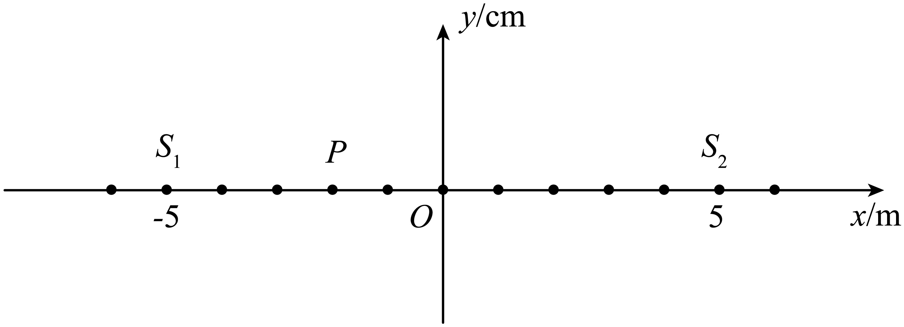

# Physics - 题目 930

**ID**: 67f8c8ed3e1e400488f35939c047bb2c
**年级**: Grade 11
**难度**: Medium-Hard
**题型**: Multiple-select

## 题目
如图所示， $x$ 轴上位于-5m、5m处各有一个波源 $S{{}_{1}}$ 、 $S{{}_{2}}$ ，可分别形成沿 $x$ 轴方向传播的简谐横波。​​​​​​​‌ $t=0$ 时刻，两波源同时开始振动，波源 $S{{}_{1}}$ 的振动方程为 $y=10\sin πt{\rm{c}}{\rm{m}}$ ，波源 $S{{}_{2}}$ 的振动方程为 $y=-10\sin πt{\rm{c}}{\rm{m}}$ ，两列波的波速均为 $2{\rm{m}}{\rm{/}}{\rm{s}}$ ， $P$ 点的坐标为 $x=-2{\rm{m}}$ ，下列说法正确的是（      ）

## 解答

1. 由两波源的振动方程可知两波源的起振方向相反，由 $S{{}_{1}}O=OS{{}_{2}}$ ，可知两列波发生干涉后，原点 $O$ 为振动减弱点，故A错误；由波源的振动方程可知波源的振动周期为 $T=2{\rm s}$ ，波源 $S{{}_{1}}$ 的振动传播到P点的时间 $t{{}_{1}}=\frac {S{{}_{1}}P}{v}=\frac {3}{2}{\rm s}=1.5{\rm s}$ ，波源 $S{{}_{2}}$ 的振动传播到P点的时间 $t{{}_{2}}=\frac {S{{}_{2}}P}{v}=\frac {7}{2}{\rm s}=3.5{\rm s}$ ，两列波发生干涉后，原点 $O$ 为振动减弱点，两列波的振幅相等，所以 $0～10{\rm{s}}$ 内 $P$ 点运动的时间为 $t=t{{}_{2}}-t{{}_{1}}=2{\rm s}=T$ ，则 $0～10{\rm{s}}$ 内 $P$ 点运动的路程为 $s=4A=40{\rm cm}$ ，故B正确；波长 $λ=vT=4{\rm m}$ ，由于两个波源的振动方向始终相反，可知波程差为 $\frac {λ}{2}$ 偶数倍时为振动减弱点，设减弱点的坐标为 $x{{}_{0}}$ ，则有 $\left ({x{{}_{0}}+5}\right )-\left ({5-x{{}_{0}}}\right )=2x{{}_{0}}=\left |{nλ}\right |=\left |{4n}\right |$  $\left ({-5{\rm m}{\rm{<}}x{{}_{0}}{\rm{<}}5{\rm m}}\right )$ ，当n=0时 $x{{}_{0}}=0$ ，当 $n=\pm 1$ 时 $x{{}_{0}}=\pm 2{\rm m}$ ，当 $n=\pm 2$ 时 $x{{}_{0}}=\pm 4{\rm m}$ ，当 $n=\pm 3$ 时 $x{{}_{0}}=\pm 6{\rm m}$ （舍去），则x轴上 $S{{}_{1}}$ 、 $S{{}_{2}}$ 之间振动减弱点的个数为5个，故C错误；两列波发生干涉后，原点 $O$ 为振动减弱点， $S{{}_{1}}$ 、 $S{{}_{2}}$ 之间各点的振幅为 $A{^{^{′}}}=\left |{2A\sin \left ({\frac {2π}{λ}x}\right )}\right |=\left |{20\sin \left ({\frac {π}{2{\rm m}}x}\right ){\rm cm}}\right |$  $\left ({-5{\rm m}{\rm{<}}x{\rm{<}}5{\rm m}}\right )$ ，若 $A{^{^{′}}}=10{\rm cm}$ ，则 $x=2n\pm \frac {1}{3}{\rm{m}}$ ，其中 $n$ 的取值为 $-2，-1，0，1，2$ ，故D正确。

## 知识点

**中文**:
  - 波的加强点与减弱点相关问题

**English**:
  - Constructive and Destructive Interference Points

---
