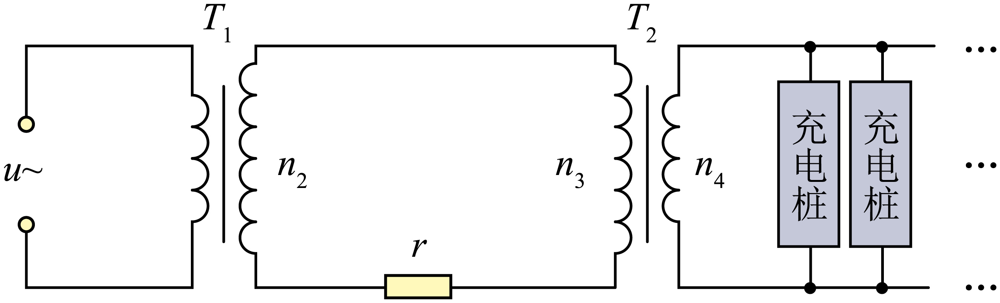

# Physics - 题目 792

**ID**: 79347b28eb83470188492d0ec7f21a70
**年级**: Grade 11
**难度**: Medium-Hard
**题型**: Multiple-select

## 题目
图为通过远距离输电方式给新能源汽车充电桩供电示意图，两变压器均为理想变压器，升压变压器 ${\rm{T}}{{}_{1}}$ 和降压变压器 ${\rm{T}}{{}_{2}}$ 的原、副线圈匝数比分别为 $n{{}_{1}}:n{{}_{2}}=1:16$ 、 $n{{}_{3}}:n{{}_{4}}=78:5$ ，输电线总电阻为 $r=2Ω$ 。​​​​​​​‌在 ${\rm{T}}{{}_{1}}$ 的原线圈两端接入一电压为 $u=250\sqrt {2}{\rm{s}}{\rm{i}}{\rm{n}}100πt\left ({\,{\rm{V}}}\right )$ 的交流电。不考虑其它因素的影响，下列说法正确的是（      ）

## 解答

1. 由 $u=250\sqrt {2}{\rm{s}}{\rm{i}}{\rm{n}}100πt\left ({{\rm{V}}}\right )$ 可知 $ω=100π$ ，则周期为 $T=\frac {2π}{ω}=0.02{\rm s，A}$ 错误；若充电桩消耗的功率增大，则电源输入总功率变大，因为总电压不变，由 $I=\frac {P}{U}$ 可知升压变压器原线圈电流变大，升压变压器副线圈电流变大，则输电线上的损耗电压变大，降压变压器原线圈电压变小，则 ${\rm{T}}{{}_{2}}$ 的输出电压减小,B正确。 ${\rm{T}}{{}_{1}}$ 的输入电压为 $U{{}_{1}}=\frac {u{{}_{{\rm{m}}}}}{\sqrt {2}}=250{\rm V}$ ， ${\rm{T}}{{}_{1}}$ 的输入功率为 $200{\rm{k}}{\rm{W}}$ 时，则电流为 $I{{}_{1}}=\frac {P}{U{{}_{1}}}=800{\rm A}$ ，根据 $\frac {n{{}_{1}}}{n{{}_{2}}}=\frac {I{{}_{2}}}{I{{}_{1}}}$ ，解得 $I{{}_{2}}=50{\rm A}$ ，输电线上损失的电功率为 $P{{}_{损}}{\rm{=}}I{{}_{2}^{2}}r=5\times 10{^{3}}{\rm{W}}{\rm ，C}$ 错误；根据 $\frac {U{{}_{1}}}{U{{}_{2}}}=\frac {n{{}_{1}}}{n{{}_{2}}}$ ，解得 $U{{}_{2}}=4000{\rm V}$ ，输电线两端的电压为 $U{{}_{损}}=I{{}_{2}}r=100{\rm V}$ ，则 $U{{}_{3}}=U{{}_{2}}-U{{}_{损}}=3900{\rm V}$ ，根据 $\frac {U{{}_{3}}}{U{{}_{4}}}=\frac {n{{}_{3}}}{n{{}_{4}}}$ ，解得 $U{{}_{4}}=250{\rm V，D}$ 正确；

## 知识点

**中文**:
  - 电能的输送

**English**:
  - Transmission of Electrical Energy

---
