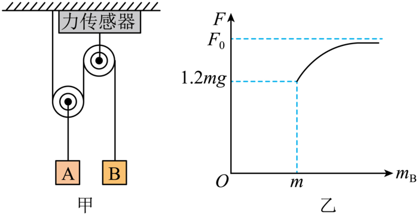

# Physics - 题目 1343

**ID**: 8513ef8569b74f32ae47c08b34199e5d
**年级**: Grade 11
**难度**: Medium-Hard
**题型**: Multiple-select

## 题目
如图甲所示，轻质动滑轮下方悬挂重物A，轻质定滑轮悬挂在一个力传感器的正下方，在轻质定滑轮下方悬挂重物B，悬挂滑轮的轻质细线竖直。​​​​​​​‌开始时，重物A、B均处于静止状态，A质量为 $m$ ，静止释放B后A、B开始运动。初始两滑轮之间竖直距离足够大，运动过程中各物体不会互相碰撞。假设摩擦阻力和空气阻力均忽略不计，重力加速度为 $g$ 。保持A物体质量 $m$ 不变，使B物体质量从 $m$ 增大，通过计算机描绘得到传感器对定滑轮的拉力 $F$ 随B物体质量 $m{{}_{B}}$ 变化关系曲线如图乙所示， $F=F{{}_{0}}$ 直线是曲线的渐近线（ $F{{}_{0}}$ 的值可用 $m$ 、 $g$ 表示）。下列说法正确的是（      ）

## 解答

1. 若B质量为 $2m$ ，由甲图可知B下降 $h$ 时，A上升 $0.5h$ ，即 $a{{}_{{\rm{B}}}}=2a{{}_{{\rm{A}}}}$ ，对B有 $2mg-T=2ma{{}_{{\rm{B}}}}$ ，对A则 $2T-mg=ma{{}_{{\rm{A}}}}$ ，解得 $T=\frac {2}{3}mg$ ， $a{{}_{{\rm{B}}}}=\frac {2}{3}g$ ，选项A正确，B错误；当传感器对定滑轮的拉力 $F$ 趋近于 $F{{}_{0}}$ 时，即 $m{{}_{{\rm{B}}}}$ 远大于 $m{{}_{{\rm{A}}}}$ ， $a{{}_{{\rm{B}}}}$ 趋近于 $g$ ， $a{{}_{{\rm{A}}}}$ 趋近于 $0.5g$ ，选项C错误；对B有 $m{{}_{{\rm{B}}}}g-T=m{{}_{{\rm{B}}}}a{{}_{{\rm{B}}}}$ ，对A有 $2T-mg=ma{{}_{{\rm{A}}}}$ ，解得 $T=\frac {3mm{{}_{{\rm{B}}}}g}{4m{{}_{{\rm{B}}}}+m}=\frac {3mg}{4+\frac {m}{m{{}_{{\rm{B}}}}}}$ ，分析可知当 $m{{}_{{\rm{B}}}}$ 增大时， $T$ 也随之增大，当 $m{{}_{{\rm{B}}}}$ 无限大时， $T=\frac {3}{4}mg$ ，对轻质定滑轮分析 $F{{}_{0}}=2T=\frac {3}{2}mg$ ，选项D正确。

## 知识点

**中文**:
  - 牛顿运动定律与图像结合问题
  - 连接体问题（整体和隔离法）、临界问题

**English**:
  - Newton's Laws and Graphs
  - Connected Bodies Problems (Whole/Isolation Method), Critical Problems

---
