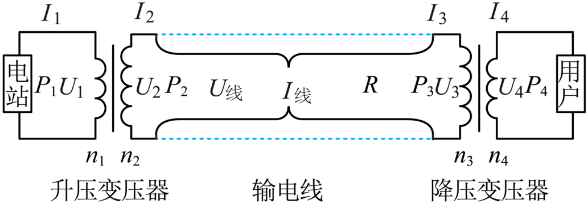

# Physics - 题目 2324

**ID**: 911b7f61636e46d09a2546e8d650eac7
**年级**: Grade 11
**难度**: Medium-Hard
**题型**: Multiple-select

## 题目
2011年9月28 日，中国第二条特高压交流电项目获批，国家电网副总经理舒印彪表示： 该公司第二条特高压交流电项目已获得发改委批准，投资规模、线路长度和输电容量都比之前项目大一倍以上。​​​​​​​‌如图所示是远距离输电示意图，电站的输出电压U_{1}=250 V，输出功率P_{1}= 100 kW，输电线电阻R=8Ὢ。则进行远距离输电时，下列说法中正确的是（      ）

## 解答

1. 电站的输出电压没有变，升压变压器的匝数不变，所以升压变压器的输出电压不变，电站的输出功率突然增大，则根据 $P=UI$ ，输电线上的电流增大，根据 $U{{}_{损}}=I{{}_{线}}R，U{{}_{3}}=U{{}_{2}}-U{{}_{损}}$ ，可得，降压变压器的输入电压 $U{{}_{3}}$ 减小，降压变压器的匝数不变，所以降压变压器的输出电压减小，故A错误；B正确；输电线损耗比例为5%时，根据 $\Delta P=I{^{2}}R，\Delta P=5％P$ ，解得 $I=25{\rm{A}}$ ，升压变压器的电流为 $I^{′}=\frac {P}{U}=400{\rm{A}}$ ，升压变压器的匝数比为 $\frac {n{{}_{1}}}{n{{}_{2}}}=\frac {I}{I^{′}}=\frac {1}{16}$ ，故C正确；输送电流为 $I{}=\frac {P}{U}=10{\rm{A}}$ ，损失功率为 $\Delta P=I{^{2}}R=800{\rm{W}}$ ，故D错误。

## 知识点

**中文**:
  - 理想变压器原、副线圈两端的电压、功率、电流关系及其应用
  - 电能的输送

**English**:
  - Voltage, Power, Current Relations in Ideal Transformers
  - Transmission of Electrical Energy

---
