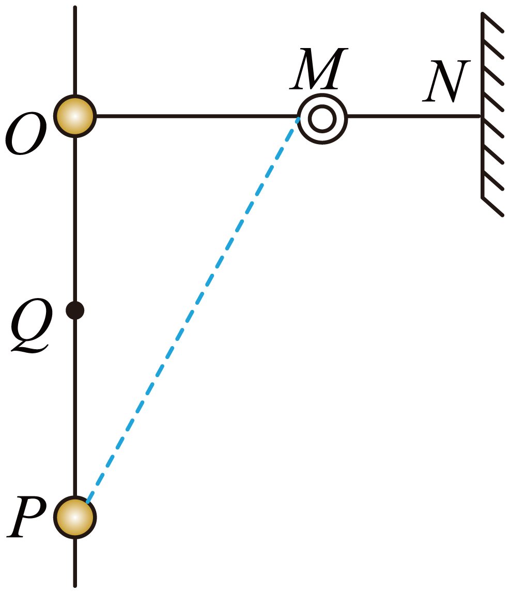

# Physics - 题目 597

**ID**: 9e72614a136943de8b37c32d7dba43db
**年级**: Grade 11
**难度**: Medium-Hard
**题型**: Multiple-select

## 题目
如图所示，一质量为5 kg的小球穿过粗糙的竖直杆，轻质弹性绳的左端与小球相连，右端固定在墙上N点，弹性绳跨过固定在M处的光滑小滑轮，O为竖直杆上的一点，O、M、N在同一水平线上，弹性绳的自然长度和 $MN$ 间距离相同。​​​​​​​‌小球从O点静止释放，到达最低点P后又继续向上运动，Q为 $OP$ 中点。已知O、M间距为4m，O、Q间距为3m，小球与杆间动摩擦因数为0.5，重力加速度 $g=10{\rm{m}}{\rm{/}}{\rm{s}}{^{2}}$ ，绳中弹力始终遵从胡克定律，最大静摩擦力等于滑动摩擦力。则下列说法正确的是（      ）

## 解答

1. A．设弹性绳与竖直方向的夹角为 $θ$ ，弹性绳的弹力为 $kl$ （l为弹性绳与滑轮所在M点及杆上O点构成的直角三角形的斜边长），当小球从O点沿着杆下降的过程中，对小球做受力分析，如图所示：
2. 
3. 弹性绳的弹力在水平方向的分力大小为 $F{{}_{x}}=kl\sin θ$ ，由几何关系可知， $l\sin θ$ 始终等于 $d{{}_{OM}}$ 的长度，因此可知弹性绳的弹力在水平方向的分力大小始终不变，而 $F{{}_{x}}=N$ ， $f=μN$ ，可知小球在竖直杆上滑动的过程中摩擦力始终不变，A错误；
4. B．对小球在O点向P点运动的过程中竖直方向上受力分析可得 $F{{}_{合}}=mg-f-kl{\cos}θ$ ，其中 $l{\cos}θ$ 始终等于小球从O点下落的距离，设为x，则有 $F{{}_{合1}}=mg-f-kx$ ，重力和摩擦力为恒力，以上等式关系可类比弹簧振子在最大位移处竖直向下做简谐振动时合力的变化，而Q为 $OP$ 的中点，则可知小球第一次运动至Q点时速度最大，B正确；
5. C．小球在Q点时，此时小球处于平衡状态，有 $mg=μkl\sin θ+kl{\cos}θ$ ，其中 $l\sin θ=4{\rm{m}}$ ， $l{\cos}θ=3{\rm{m}}$ ，解得 $k=10{\rm{N}}{\rm{/}}{\rm{m}}{\rm ，C}$ 正确；
6. D．从P点返回的过程中，摩擦力向下，竖直方向有 $F{{}_{合2}}=mg+f-kx$ ，类比小球第一次下降的过程，若合力不变，则小球仍然在上升至Q点时速度达到最大，但实际上在小球第一次从最低点P上升的过程中，竖直向下的力增大了，则小球需要克服阻碍其运动的力而做的功增加了，因此从能量的角度考虑，小球从P点返回的过程中，速度最大的位置一定在Q点的下方，小球每次下降后再上升的过程中其平衡位置都在下降，由此可知，当小球最终停止时一定停在Q点下方的某一位置处，D正确。选BCD。

## 知识点

**中文**:
  - 解析法在解动态平衡问题中的应用

**English**:
  - Analytical Method for Dynamic Equilibrium

---
