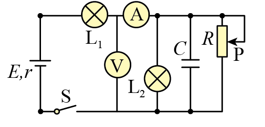

# Physics - 题目 286

**ID**: a2d3ef1788344832a4a8ddb502fbf596
**年级**: Grade 11
**难度**: Medium-Hard
**题型**: Multiple-select

## 题目
在如图所示的电路中，当闭合开关S后，若将滑动变阻器的滑片P向下调节，不考虑灯泡电阻的变化，已知电源的内阻小于灯泡 ${\rm{L}}{{}_{1}}$ 电阻，电流表和电压表均为理想电表，电流表、电压表示数变化量的大小分别为 $ΔI$ 、 $\Delta U$ ，则下列说法正确的是（      ）​​​​​​​‌

## 解答

1. 由题可知，电源的内阻小于电路的外电阻；当滑片P向下调节，滑动变阻器的阻值R减小，电路的外电阻减小，根据电源的输出功率特性可知，电源输出功率增大；滑动变阻器的阻值R减小，则电路中的总电阻 $R{{}_{总}}$ 减小，由闭合电路欧姆定律可得，电路中的总电流 $I{{}_{总}}$ 增大，电路内压 $U{{}_{\mathrm{内}}}$ 增大，路端电压 $U{{}_{外}}$ 减小，由电源的效率得 $η=\frac {P{{}_{出}}}{P{{}_{总}}}\times 100\%=\frac {U{{}_{外}}I{{}_{总}}}{EI{{}_{总}}}\times 100\%=\frac {U{{}_{外}}}{E}\times 100\%$ ，即电源效率减小，A正确；由图可知， $\frac {U}{I}$ 等于灯泡 ${\rm{L}}{{}_{2}}$ 的电阻 $R{{}_{2}}$ 与滑动变阻器的电阻R的并联电阻，由于滑动变阻器的阻值R减小，则 $\frac {U}{I}$ 减小。根据闭合电路欧姆定律有 $E=U+I(r+R{{}_{1}})$ ，可知 $\frac {{\rm{Δ}}U}{{\rm{Δ}}I}=r+R{{}_{1}}$ ，因不考虑灯泡电阻的变化，则滑片P向下调节时， $\frac {ΔU}{ΔI}$ 不变，B错误；由以上分析可知，灯泡 ${\rm{L}}{{}_{1}}$ 的电流增大，亮度变大，即电流表的示数增大；由于 ${\rm{L}}{{}_{1}}$ 的电压 $U{{}_{1}}$ 增大，又路端电压 $U{{}_{外}}$ 减小，所以灯 ${\rm{L}}{{}_{2}}$ 和电容器两端的电压 $U{{}_{2}}$ 都减小，即电压表示数减小；所以灯 ${\rm{L}}{{}_{2}}$ 变暗， ${\rm{L}}{{}_{2}}$ 的电流 $I{{}_{2}}$ 也减小，又总电流增大，所以通过R的电流增大，C错误，D正确。

## 知识点

**中文**:
  - 电路的动态分析问题
  - 闭合电路输出功率与效率

**English**:
  - Dynamic Circuit Analysis
  - Output Power and Efficiency of Closed Circuits

---
