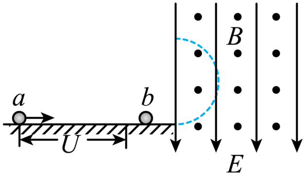

# Physics - 题目 1058

**ID**: a406e0fd198749adb16655a05acd2141
**年级**: Grade 11
**难度**: Medium-Hard
**题型**: Multiple-select

## 题目
如图，光滑绝缘水平面的右侧存在着匀强电场和匀强磁场组成的复合场，电场方向竖直向下，磁场方向水平向外，磁感应强度大小为B；一电荷量为q、质量为m的小球a在水平面上从静止开始经电压U加速后，与静止着的另一相同质量的不带电金属小球b发生碰撞并粘在一起，此后水平向右进入复合场中，在竖直面内做匀速圆周运动。​​​​​​​‌电荷量的损失不计，重力加速度大小为g。下列判断正确的是（      ）

## 解答

1. 小球a、b碰撞后在竖直面内做匀速圆周运动，则重力和电场力平衡，所以电场力竖直向上，小球a带负电，A错误；小球a加速过程，由动能定理得 $qU=\frac {1}{2}mv{{}_{0}}{^{2}}$ ，碰撞过程由动量守恒定律得 $mv{{}_{0}}=2mv$ ，解得 $v=\frac {1}{2}\sqrt {\frac {2qU}{m}}{\rm ，B}$ 正确；小球a、b碰撞后在竖直面内做匀速圆周运动，由牛顿第二定律得 $qvB=2m\frac {v{^{2}}}{r}$ ，解得 $r=\frac {1}{B}\sqrt {\frac {2mU}{q}}{\rm ，C}$ 错误；洛伦兹力不做功，电场力做功为 $W=qE\times 2r=\frac {4mg}{B}\sqrt {\frac {2mU}{q}}$ ，所以机械能减少量 $ΔE=\frac {4mg}{B}\sqrt {\frac {2mU}{q}}{\rm ，D}$ 正确。

## 知识点

**中文**:
  - 动量守恒的判定与应用
  - 带电粒子在叠加场中的运动

**English**:
  - Judgment and Application of Momentum Conservation
  - Motion in Superimposed Fields

---
