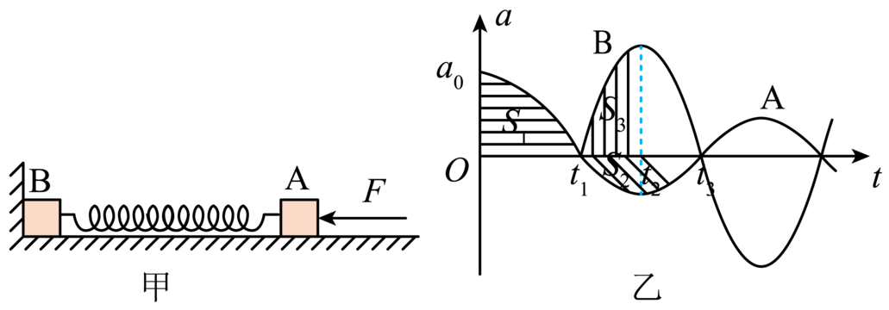

# Physics - 题目 2295

**ID**: aeb62e23fd5c45a398c16c486b679fc4
**年级**: Grade 11
**难度**: Medium-Hard
**题型**: Multiple-select

## 题目
如图甲所示，质量分别为 $m{{}_{{\rm{A}}}}$ 、 $m{{}_{{\rm{B}}}}$ 的A、B两物体用轻弹簧连接构成一个系统，外力F作用在A上，系统静止在光滑水平面上（B靠墙面），此时弹簧形变量为x。​​​​​​​‌撤去外力并开始计时，A、B两物体运动的加速度a随时间t变化的图像如图乙所示， $S{{}_{1}}$ 表示0到 $t{{}_{1}}$ 时间内A的 $a-t$ 图线与坐标轴所围面积的大小， $S{{}_{2}}$ ， $S{{}_{3}}$ 分别表示 $t{{}_{1}}$ 到 $t{{}_{2}}$ 时间内A、B的 $a-t$ 图线与坐标轴所围面积的大小。下列说法正确的是（      ）

## 解答

1. AB．a-t图线与坐标轴所围图形的面积等于物体速度的变化量，则因初速度为零，t_{1}时刻A的速度大小
2. v_{0}=S_{1}
3. t_{2}时刻A的速度大小
4. v_{A}=S_{1}-S_{2}
5. B的速度大小
6. v_{B}=S_{3}
7. 由图（b）所示图象可知，t_{1}时刻A的加速度为零，此时弹簧恢复原长，B开始离开墙壁，到t_{2}时刻两者加速度均达到最大，弹簧伸长量达到最大，此时两者速度相同，即
8. v_{A}=v_{B}
9. 则
10. S_{1}-S_{2}=S_{3}
11. t_{1}到t_{2}时刻A、B两物体满足动量守恒，则有
12. $m{{}_{{\rm{A}}}}v{{}_{0}}=\left ({m{{}_{{\rm{A}}}}+m{{}_{{\rm{B}}}}}\right )v{{}_{共}}$
13. 即
14. $m{{}_{{\rm{A}}}}S{{}_{1}}=\left ({m{{}_{{\rm{A}}}}+m{{}_{{\rm{B}}}}}\right )S{{}_{3}}$
15. 联立以上解得
16. $m{{}_{{\rm{A}}}}:m{{}_{{\rm{B}}}}=S{{}_{3}}:S{{}_{2}}$
17. 故AB正确；
18. C．撤去外力后A受到的合力等于弹簧的弹力，0到t_{1}时间内，对A，由动量定理可知，合力即弹簧弹力对A的冲量大小
19. I=m_{A}v_{0}
20. 弹簧对A与对B的弹力大小相等、方向相反、作用时间相等，因此弹簧对B的冲量大小与对A的冲量大小相等、方向相反，即弹簧对B的冲量大小
21. I_{弹}_{簧}=m_{A}v_{0}
22. 对B，以向右为正方向，由动量定理得
23. I_{墙}_{壁}-I_{弹}_{簧}=0
24. 解得墙对B的冲量大小
25. I_{墙}_{壁}=m_{A}v_{0}
26. 方向水平向右，故C错误；
27. D．运动后，当A、B速度相等时弹簧形变量（伸长量或压缩量）最大，此时A、B的速度不为零，A、B的动能不为零，由能量守恒定律可知，弹簧形变量最大时A、B的动能与弹簧的弹性势能之和与撤去外力时弹簧的弹性势能相等，则弹簧形变量最大时弹簧弹性势能小于撤去外力时弹簧的弹性势能，弹簧形变量最大时弹簧的形变量小于撤去外力时弹簧的形变量x，故D错误。
28. 故选AB。

## 知识点

**中文**:
  - 动量守恒与弹簧相结合

**English**:
  - Momentum Conservation with Springs

---
