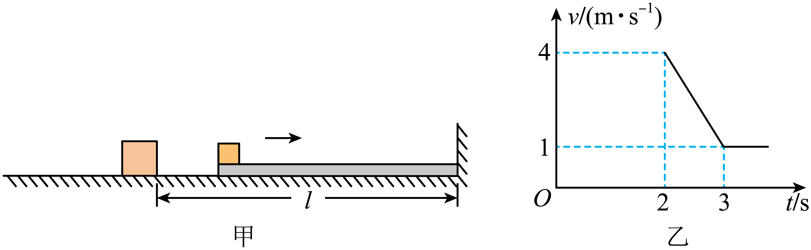

# Physics - 题目 923

**ID**: b293b7fc1f1548c1bd6976ef07906bf4
**年级**: Grade 11
**难度**: Medium-Hard
**题型**: Multiple-select

## 题目
如图甲所示，长木板处于光滑的水平面上，右端紧靠墙壁，墙壁左侧l=16m处放有一物块P，P的质量是木板质量的2倍，t=0时，一小铁块质量为m=1kg从左端以某一速度滑上长木板，t=2s时铁块与墙壁碰撞，碰撞后铁块速度随时间变化关系如图乙所示。​​​​​​​‌不计所有碰撞的机械能损失，重力加速度 $g=10{\rm{m}}{\rm{/}}{\rm{s}}{^{{{2}}}}$ ，则以下描述正确的是（      ）

## 解答

1. 铁块撞墙后在木板上做匀减速直线运动。铁块的加速度大小为 $a{{}_{1}}=\frac {4-1}{3-2}{\rm{m}}{\rm{/}}{\rm{s}}{^{2}}=3{\rm{m}}{\rm{/}}{\rm{s}}{^{2}}$ ，根据牛顿第二定律 ${\rm }{\rm μm}g=ma{{}_{1}}{\rm }$ ，解得 $μ=0.3{\rm ，A}$ 正确；铁块撞墙前在木板上做匀减速直线运动，加速度大小为3m/s^{2}，经过t=2s速度减小为 $v{{}_{1}}=4{\rm{m}}{\rm{/}}{\rm{s}}$ ，铁块滑上木板时的初速度为 $v{{}_{1}}=v{{}_{0}}-a{{}_{1}}t$ ，解得 $v{{}_{0}}=10{\rm{m}}{\rm{/}}{\rm{s}}$ ，木板的长度为 $l{{}_{0}}=\frac {v{{}_{0}}+v{{}_{1}}}{2}t=14{\rm{m}}{\rm ，B}$ 正确；铁块撞墙后在木板上做匀减速直线运动，木板做匀加速直线运动，经过1s达到共同速度v_{2}=1m/s。木板的位移 $x{{}_{1}}=\frac {0+1}{2}\times 1{\rm{m}}=0{{.}}5{\rm{m}}$ ，铁块的位移为 $x{{}_{2}}=\frac {4+1}{2}\times 1{\rm{m}}=2{{.}}5{\rm{m}}$ ，铁块和木板达到共同速度后共同向左运动的位移为 $x{{}_{3}}=l-l{{}_{0}}-x{{}_{1}}=2.5{\rm{m}}$ ，设木板的质量为M，对铁块和木板根据动量守恒定律， $mv{{}_{1}}=\left ({m+M}\right )v{{}_{2}}$ ，解得 $M=3m$ ，木板与物块P碰撞，碰撞后，木板的速度为v_{3}，物块P的速度为v_{4}。，对木板和物块P根据动量守恒定律 $Mv{{}_{2}}=-Mv{{}_{3}}+2Mv{{}_{4}}$ ，根据机械能守恒定律 $\frac {1}{2}Mv{{}_{2}}{^{2}}=\frac {1}{2}Mv{{}_{3}}{^{2}}+\frac {1}{2}\cdot 2Mv{{}_{4}}{^{2}}$ ，解得 $v{{}_{3}}=\frac {1}{3}{\rm{m}}{\rm{/}}{\rm{s}}$ ，对铁块和木板根据动量守恒定律 $mv{{}_{2}}-Mv{{}_{3}}=\left ({m+M}\right )v{{}_{5}}$ ，解得 $v{{}_{5}}=0$ ，铁块和木板最终静止在水平面上。，铁块继续向左运动的位移 $x{{}_{4}}=\frac {v{{}_{2}^{2}}}{2a{{}_{1}}}=\frac {1}{6}{\rm{m}}$ ，小铁块离墙壁的最远距离为 $x=x{{}_{2}}+x{{}_{3}}+x{{}_{4}}=\frac {25}{6}{\rm{m}}$ ，小铁块离墙壁的最远距离 $\frac {25}{6}{\rm{m}}$ ，小于木板长度14m，小铁块没有滑出木板，没有与物块P发生碰撞。C错误，D正确。

## 知识点

**中文**:
  - 动量守恒与板块模型相结合

**English**:
  - Momentum Conservation with Plate Models

---
