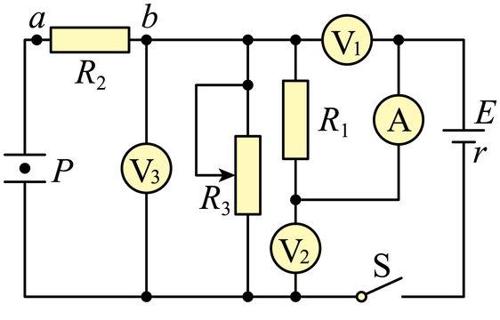

# Physics - 题目 1763

**ID**: b6021b3381204acc9e4789d396810999
**年级**: Grade 11
**难度**: Medium-Hard
**题型**: Multiple-select

## 题目
在如图所示的电路中，电源电动势 $E$ 、内阻 $r$ 恒定， $R{{}_{1}}$ 、 $R{{}_{2}}$ 是定值电阻。​​​​​​​‌闭合开关S，平行板电容器两板间有一带电液滴刚好处于静止状态。将滑动变阻器 $R{{}_{3}}$ 的滑片向上滑动，理想电压表V_{1}、V_{2}、V_{3}的示数变化量的绝对值为 $ΔU{{}_{1}}$ 、 $ΔU{{}_{2}}$ 、 $\Delta U{{}_{3}}$ ，电流表A是理想电流表。下列说法正确的是（      ）

## 解答

1. A．分析电路可知，当开关S闭合，滑动变阻器与定值电阻 $R{{}_{1}}$ 串联后接在电源两端；将滑动变阻器的滑片向上滑动，滑动变阻器接入电路的电阻变大，电路总电阻变大，电路电流减小，理想电流表A示数减小；理想电压表V_{1}测量定值电阻 $R{{}_{1}}$ 两端的电压，据欧姆定律可得
2. $U{{}_{1}}=IR{{}_{1}}$
3. 电路电流减小，则 $U{{}_{1}}$ 变小，即理想电压表 ${\rm{V}}{{}_{1}}$ 示数减小；而理想电压表V_{2}测量电源的路端电压，据闭合电路欧姆定律可得
4. $U{{}_{2}}=E-Ir$
5. 电路电流减小，电源内阻上分得的电压变小，电源路端电压增大，理想电压表V_{2}的示数增大，故A正确；
6. B．理想电压表V_{3}测量滑动变阻器两端的电压，据闭合电路欧姆定律可得
7. $U{{}_{3}}=E-I\left ({R{{}_{1}}+r}\right )$
8. 电路电流减小，则 $U{{}_{3}}$ 增大；理想电压表V_{1}测量定值电阻 $R{{}_{1}}$ 两端的电压，据欧姆定律可得
9. $U{{}_{1}}=IR{{}_{1}}$
10. 理想电压表V_{2}测量电源的路端电压，据闭合电路欧姆定律可得
11. $U{{}_{2}}=E-Ir$
12. 故
13. $\frac {{\rm{Δ}}U{{}_{3}}}{{\rm{Δ}}I}=\left ({R{{}_{1}}+r}\right )$ ， $\frac {{\rm{Δ}}U{{}_{1}}}{{\rm{Δ}}I}=R{{}_{1}}$ ， $\frac {{\rm{Δ}}U{{}_{2}}}{ΔI}=r$
14. 所以
15. $ΔU{{}_{3}}=ΔU{{}_{1}}+ΔU{{}_{2}}$
16. 故B错误；
17. C．根据
18. $C=\frac {Q}{U{{}_{3}}}$
19. 可知电容器的电荷量Q增大，电容器充电，所以定值电阻 $R{{}_{2}}$ 中有从b流向a的瞬间电流，又
20. $E=\frac {U{{}_{3}}}{d}{\rm \mathit{E}}$ 增大，向上的电场力增大，则带电液滴将向上运动，故C正确；
21. D．电源效率
22. $η=\frac {I{^{2}}R{{}_{外}}}{I{^{2}}(R{{}_{外}}+r)}=\frac {R{{}_{外}}}{R{{}_{外}}+r}=\frac {1}{1+\frac {r}{R{{}_{外}}}}$
23. 滑动变阻器接入电路的电阻变大，外电路总电阻变大，电源效率变大，故D错误。
24. 故选AC。

## 知识点

**中文**:
  - 电容器的充放电过程及其动态分析
  - 电路的动态分析问题

**English**:
  - Capacitor Charge/Discharge and Dynamic Analysis
  - Dynamic Circuit Analysis

---
