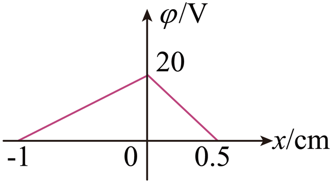

# Physics - 题目 1930

**ID**: bce9d0e5195e492b8e56772ee6bb31f6
**年级**: Grade 11
**难度**: Medium-Hard
**题型**: Multiple-select

## 题目
反射式速调管是常用的微波器件之一，它利用电子团在电场中的振荡来产生微波，其振荡原理与下述过程类似。​​​​​​​‌已知静电场的方向平行于x轴，其电势 $φ$ 随x的分布如图所示，一质量 $m=4.0\times 10{^{-20}}{\rm{k}}{\rm{g}}$ ，电荷量 $q=-4.0\times 10{^{-9}}{\rm{C}}$ 的带负电的粒子从 $(-1{\rm{c}}{\rm{m}}，0)$ 点由静止开始，仅在电场力作用下在x轴上 $-1{\rm{c}}{\rm{m}}\sim 0.5{\rm{c}}{\rm{m}}$ 范围内往返运动，则（      ）

## 解答

1. A． $φ-x$ 图像中，图线的斜率的绝对值表示电场强度大小，则有
2. $E{{}_{1}}=\frac {20}{1\times 10{^{-2}}}{\rm{N}}{\rm{/}}{\rm{C}}=2000{\rm{N}}{\rm{/}}{\rm{m}}$ ， $E{{}_{2}}=\frac {20}{0.5\times 10{^{-2}}}{\rm{N}}{\rm{/}}{\rm{C}}=4000{\rm{N}}{\rm{/}}{\rm{m}}$
3. 则有
4. $\frac {E{{}_{1}}}{E{{}_{2}}}=\frac {1}{2}$
5. A正确；
6. B．由于沿电场线，电势降低，可知x轴负半轴上的电场方向向左，x轴正半轴上的电场方向向右，粒子带负电，粒子在x轴负半轴上的电场力方向向右，粒子在x轴正半轴上的电场力方向向左，可知粒子从 $-1{\rm{c}}{\rm{m}}$ 运动至 $0.5{\rm{c}}{\rm{m}}$ 过程中，电场力先做正功后做负功，B正确；
7. C．该粒子运动过程中电势能变化量的最大值为
8. $4.0\times 10{^{-9}}\times \left ({20-0}\right ){\rm{J}}=8.0\times 10{^{-8}}{\rm{J}}$
9. C错误；
10. D．粒子在x轴负半轴上有
11. $qE{{}_{1}}=ma{{}_{1}}$ ， $x{{}_{1}}=\frac {1}{2}a{{}_{1}}t{{}_{1}^{2}}$
12. 解得
13. $t{{}_{1}}=1.0\times 10{^{-8}}{\rm{s}}$
14. 粒子在x轴正半轴上有
15. $qE{{}_{2}}=ma{{}_{2}}$ ， $x{{}_{2}}=\frac {1}{2}a{{}_{2}}t{{}_{2}^{2}}$
16. 解得
17. $t{{}_{2}}=5.0\times 10{^{-9}}{\rm{s}}$
18. 则该粒子运动的周期
19. $T=2\left ({t{{}_{1}}+t{{}_{2}}}\right )=3.0\times 10{^{-8}}{\rm{s}}$
20. D正确。
21. 故选ABD。

## 知识点

**中文**:
  - 静电场中的图像问题

**English**:
  - Graph Problems in Electrostatic Fields

---
