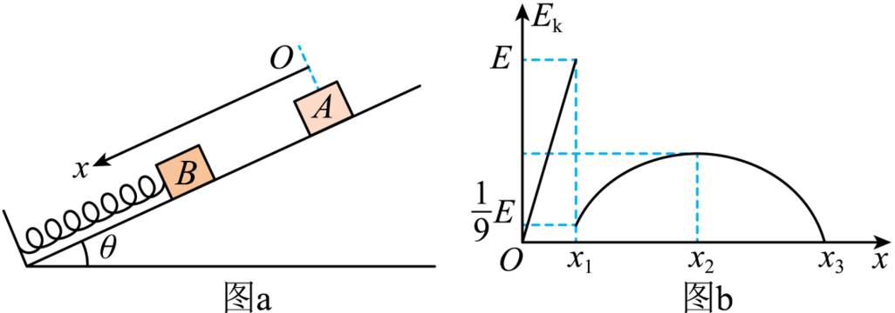

# Physics - 题目 1156

**ID**: c042eadf476941ff80727e05bb3f23c2
**年级**: Grade 11
**难度**: Medium-Hard
**题型**: Multiple-select

## 题目
如图a所示，轻弹簧下端固定在倾角为θ的光滑斜面底端，上端与物块B相连，物块B处于静止状态，现将物块A置于斜面物块B上方某位置处，取物块A的位置为原点O，沿斜面向下为正方向建立x轴坐标系，某时刻释放物块A，A与物块B碰撞后以共同速度沿斜面向下运动，碰撞时间极短，测得物块A的动能E_{k}与其位置坐标x的关系如图b所示，图像中0 ~x_{1}之间为直线，其余部分为曲线，物块A、B均可视为质点，弹簧始终处于弹性限度内，不计空气阻力，重力加速度为g，则（      ）​​​​​​​‌

## 解答

1. A．由图b可知，物块A与物块B碰撞前的动能
2. $\frac {1}{2}m{{}_{A}}v{^{2}}=E{{}_{{\rm{k}}}}$
3. 可得物块A与物块B碰撞前的速度
4. $v=\sqrt {\frac {2E{{}_{{\rm{k}}}}}{m{{}_{A}}}}$
5. 物块A与物块B碰撞后的动能
6. $\frac {1}{2}m{{}_{A}}v{{}_{共}^{2}}=\frac {1}{9}E{{}_{{\rm{k}}}}$
7. 可得物块A与物块B碰撞后的速度
8. $v{{}_{共}}=\sqrt {\frac {2E{{}_{{\rm{k}}}}}{9m{{}_{A}}}}=\frac {v}{3}$
9. 物块A与物块B碰撞时间极短，根据动量守恒定律
10. $m{{}_{A}}v=(m{{}_{A}}+m{{}_{B}})\frac {v}{3}$
11. 解得
12. $\frac {m{{}_{A}}}{m{{}_{B}}}=\frac {1}{2}$
13. A正确；
14. B．由图b可知，A与B碰撞后A在x_{2}处动能最大，则A与B碰撞后在x_{2}位置处速度最大，B错误；
15. C．根据动能定理有
16. 0 -E_{k}=F_{合}x
17. 则可知E_{k}—x图的斜率代表物体所受的合外力，由图b可知A与B碰撞后在x_{3}位置处合外力最大，即加速度最大，C正确；
18. D．弹簧上端与物块B相连，物块B处于静止状态，设此时弹簧的形变量为x_{0}，结合图a根据平衡条件可知
19. $m{{}_{B}}g{\sin}θ=kx{{}_{0}}$
20. 由图b可知，当AB一起运动到x_{2}时，速度最大，根据平衡条件
21. $m{{}_{A}}g{\sin}θ+m{{}_{B}}g{\sin}θ=k(x{{}_{2}}-x{{}_{1}}+x{{}_{0}})$
22. 物块A从O点运动到位置x_{1}的过程中，根据动能定理
23. $m{{}_{A}}g{\sin}θx{{}_{1}}=E{{}_{{\rm{k}}}}$
24. 联立解得
25. $k=\frac {E{{}_{{\rm{k}}}}}{x{{}_{1}}(x{{}_{2}}-x{{}_{1}})}$
26. D正确。
27. 故选ACD。

## 知识点

**中文**:
  - 求解非弹性碰撞问题

**English**:
  - Solving Inelastic Collision Problems

---
