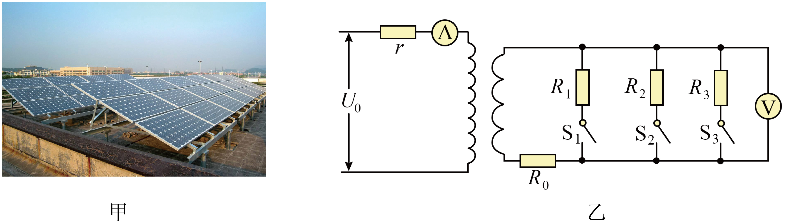

# Physics - 题目 621

**ID**: d00a89d010034a3497ba9f9ab7a46813
**年级**: Grade 11
**难度**: Medium-Hard
**题型**: Multiple-select

## 题目
太阳能光伏发电是利用太阳电池将太阳光能直接转化为电能的一项新兴技术(如图甲)。​​​​​​​‌如图乙所示为某光伏发电站输电入户的示意图，其中输电电压的有效值 $U{{}_{0}}$ 恒定， $r$ 是输电线的等效电阻，变压器为理想变压器，电表均可视为理想电表，下列说法正确的是（      ）

## 解答

1. 若开关 ${\rm{S}}{{}_{1}}、{\rm{S}}{{}_{2}}、{\rm{S}}{{}_{3}}$ 均断开，变压器输入电压决定输出电压，输出电流决定输入电流，所以电流表的示数为0，电压表的示数不为0，故A正确；开关 ${\rm{S}}{{}_{1}}、{\rm{S}}{{}_{2}}、{\rm{S}}{{}_{3}}$ 均闭合的前提下，设原线圈两端的电压为 $U{{}_{1}}$ ，电流为 $I{{}_{1}}$ ，副线圈两端的电压为 $U{{}_{2}}$ ，电流为 $I{{}_{2}}$ ，总电阻为 $R{{}_{2}}$ ；在原线圈回路中有 $U{{}_{0}}=U{{}_{1}}+I{{}_{1}}r$ ，根据电压与匝数的关系有 $\frac {U{{}_{1}}}{U{{}_{2}}}=\frac {n{{}_{1}}}{n{{}_{2}}}$ ，解得 $U{{}_{1}}=\frac {n{{}_{1}}}{n{{}_{2}}}U{{}_{2}}$ ，根据电流与匝数的关系有 $\frac {I{{}_{1}}}{I{{}_{2}}}=\frac {n{{}_{2}}}{n{{}_{1}}}$ ，解得 $I{{}_{1}}=\frac {n{{}_{2}}}{n{{}_{1}}}I{{}_{2}}$ ，在副线圈回路中有 $U{{}_{2}}=I{{}_{2}}R{{}_{2}}$ ，联立可得 $U{{}_{0}}=I{{}_{2}}\left ({\frac {n{{}_{1}}}{n{{}_{2}}}R{{}_{2}}+\frac {n{{}_{2}}}{n{{}_{1}}}r}\right )$ ，可知线路老化导致 $r$ 增大，副线圈的总电阻 $R{{}_{2}}$ 不变，则副线圈的电流 $I{{}_{2}}$ 减小，故原线圈的电流 $I{{}_{1}}$ 减小，即电流表的示数减小，故B错误；同B项分析，有 $U{{}_{0}}=I{{}_{2}}\left ({\frac {n{{}_{1}}}{n{{}_{2}}}R{{}_{2}}+\frac {n{{}_{2}}}{n{{}_{1}}}r}\right )$ ，若先让开关 ${\rm{S}}{{}_{1}}、{\rm{S}}{{}_{2}}$ 保持闭合状态，然后闭合开关 ${\rm{S}}{{}_{3}}$ ，则副线圈的总电阻 $R{{}_{2}}$ 减小，故副线圈的电流 $I{{}_{2}}$ 增大，故原线圈的电流 $I{{}_{1}}$ 增大，即电流表的示数增大，故C错误；同B项分析，有 $U{{}_{0}}=I{{}_{2}}\left ({\frac {n{{}_{1}}}{n{{}_{2}}}R{{}_{2}}+\frac {n{{}_{2}}}{n{{}_{1}}}r}\right )$ ，若先让开关 ${\rm{S}}{{}_{1}}、{\rm{S}}{{}_{2}}$ 保持闭合状态，然后闭合开关 ${\rm{S}}{{}_{3}}$ ，则副线圈的总电阻 $R{{}_{2}}$ 减小，故副线圈的电流 $I{{}_{2}}$ 增大，故原线圈的电流 $I{{}_{1}}$ 增大，根据 $U{{}_{0}}=U{{}_{1}}+I{{}_{1}}r$ ，可知原线圈两端的电压 $U{{}_{1}}$ ，则副线圈的电压 $U{{}_{2}}$ 减小；在副线圈回路中有 $U{{}_{2}}=U{{}_{{\rm{V}}}}+I{{}_{2}}R{{}_{0}}$ ，可知 $U{{}_{{\rm{V}}}}$ 变小，即电压表的示数减小，故D正确。

## 知识点

**中文**:
  - 含有理想变压器的动态电路分析
  - 电能的输送

**English**:
  - Dynamic Circuit Analysis with Ideal Transformers
  - Transmission of Electrical Energy

---
