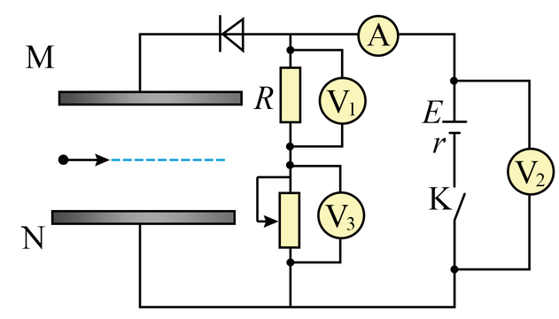

# Physics - 题目 1698

**ID**: d83a8efb48ab446db6c43e6be9677f29
**年级**: Grade 11
**难度**: Medium-Hard
**题型**: Multiple-select

## 题目
如图所示电路中电源电动势为E，内阻为r，各电表均为理想电表，滑动变阻器滑片处于中央位置，闭合电键后，一带电微粒恰好沿平行板电容器的中线飞出。​​​​​​​‌改变滑动变阻器的阻值，电压表 ${\rm{V}}{{}_{{{1}}}}$ 、 ${\rm{V}}{{}_{{{2}}}}$ 、 ${\rm{V}}{{}_{{{3}}}}$ 示数变化量的绝对值分别为 $ΔU{{}_{1}}$ 、 $ΔU{{}_{2}}$ 、 $\Delta U{{}_{3}}$ ，电流表A示数变化量的绝对值为 $ΔI$ ，则（      ）

## 解答

1. 根据图中二极管接法，可知电容器只能充电不能放电；电容器两端电压为R与滑动变阻器电压之和；题意可知起初微粒受力平衡，即电场力与重力等大反向，微粒受到的电场力竖直向上；若将滑动变阻器滑片向下移动，滑动变阻器接入电路阻值变小，根据串反并同规律，可知电容器两端电压减小，电容器要放电，由于二极管原因，电容器放不了电，即Q不变，根据 $C=\frac {Q}{U}$ ，可知电容器两端电压U不变，根据 $E=\frac {U}{d}$ ，可知电容器两极板间电场强度不变，微粒受到电场力不变，微粒仍沿中线飞出，微粒飞出时动能不变，A正确；若将滑动变阻器滑片向上移动，滑动变阻器接入电路阻值变大，根据串反并同规律，可知 ${\rm{V}}{{}_{3}}$ 变大， ${\rm{V}}{{}_{1}}、{\rm{A}}$ 示数减小，由于电流减小，根据 $U{{}_{2}}=E-Ir$ ，可知 ${\rm{V}}{{}_{{{2}}}}$ 变大，B错误；因为 $U{{}_{2}}=E-Ir$ ， $U{{}_{3}}=E-I\left ({r+R}\right )$ ，可知 $r=\frac {{\rm{Δ}}U{{}_{2}}}{{\rm{Δ}}I}，r+R=\frac {{\rm{Δ}}U{{}_{3}}}{{\rm{Δ}}I}$ ，若将滑动变阻器滑片向上移动， $\frac {ΔU{{}_{2}}}{ΔI}、\frac {ΔU{{}_{3}}}{ΔI}$ 均不变，C错误；保持滑片位置不动，则电容器两端电压不变，仅将N板向上平移少许，则极板间距缩小，根据 $E=\frac {U}{d}$ ，可知场强E增大，微粒受到的电场力增大，粒子向M板偏转，D正确。

## 知识点

**中文**:
  - 平行板电容器电容大小及其影响因素
  - 电路的动态分析问题

**English**:
  - Factors Affecting Capacitance of Parallel Plate Capacitors
  - Dynamic Circuit Analysis

---
