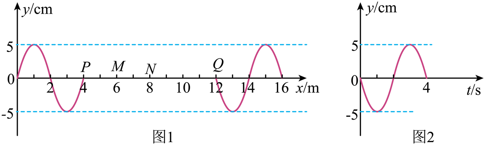

# Physics - 题目 1591

**ID**: dfa4cfa46d6b4984896f36530cbadd2c
**年级**: Grade 11
**难度**: Medium-Hard
**题型**: Multiple-select

## 题目
同种介质中，分别沿x轴正方向和负方向传播的两简谐横波，振幅均为A=5cm，t=0s；时刻波刚好传到P、Q两点，如图1所示。​​​​​​​‌P、M、N、Q在x轴上的坐标分别为：4m、6m、8m、12m。平衡位置在P处的质点振动图像如图2所示。下列说法正确的是（      ）

## 解答

1. 由图可知，两列波的周期为 $T=4{\rm{s}}$ ，波长为 $λ=4{\rm{m}}$ ，波速为 $v=\frac {λ}{T}=1{\rm{m}}{\rm{/}}{\rm{s}}$ ，则两列波相遇时间为 $t=\frac {x}{2v}=\frac {8}{2}{\rm{s}}=4{\rm{s}}{\rm ，A}$ 正确；由图可知，N点到P、Q两点的距离相等，又因为 $t=0$ 时刻P、Q两点的振动方向相同，所以N点为振动加强点，则N点的振幅为 $A{{}_{N}}=2A=10{\rm{c}}{\rm{m}}$ ，且起振方向沿 $y$ 轴负方向， $t=4{\rm{s}}$ 时N点开始振动，则 $t=5{\rm{s}}$ 时N点振动时间为 ${\rm{Δ}}t=1{\rm{s}}=\frac {T}{4}$ ，所以，此时N点处于最低点，位移为 $y{{}_{N}}=-10{\rm{c}}{\rm{m}}$ ，位移大小为-10cm，B错误； $P$ 距质点 $M$ 的距离为2m，经时间 $t{{}_{1}}=\frac {x{{}_{PM}}}{v}=2{\rm{s}}$ ，传到质点M的位置，再向下振动一个周期，运动路程 $s{{}_{1}}=20{\rm{c}}{\rm{m}}$ 时，Q距质点M的距离为6m，刚好经时间 $t{{}_{2}}=\frac {x{{}_{QM}}}{v}=6{\rm{s}}$ ，传到质点 $M$ 的位置，再同时向下振动半个周期，振动步调相同，为振动加强点，根据波的点叠加原理知，质点 $M$ 又通过路程为 $s{{}_{2}}=2A\times 2=20{\rm{c}}{\rm{m}}$ ，在t=0s到t=8s内，质点M通过的路程为 $s=s{{}_{1}}+s{{}_{2}}=40{\rm{c}}{\rm{m}}{\rm ，C}$ 正确；t≥12s后， $x$ 轴 $0<x<16{\rm{m}}$ 上范围内，波源连线上，相邻加强点相差半个波长，因此，连线上加强点的坐标，从左向右依次为2m、4m、6m、8m、10m、12m、14m，共7个，D正确。

## 知识点

**中文**:
  - 波的加强点与减弱点相关问题

**English**:
  - Constructive and Destructive Interference Points

---
