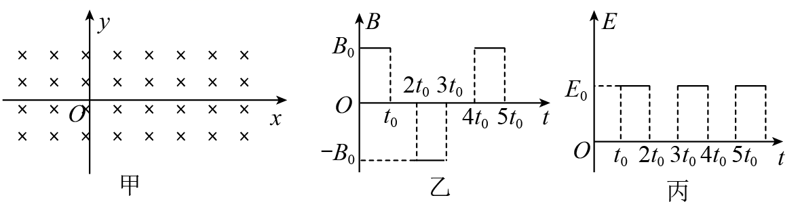

# Physics - 题目 250

**ID**: f33ed8a8e24a41229546a2c3fca5a785
**年级**: Grade 11
**难度**: Medium-Hard
**题型**: Multiple-select

## 题目
如图甲所示，在xOy平面内存在方向、大小随时间周期性变化的磁场和电场（电场未画出），变化规律分别如图乙、丙所示（规定垂直纸面向里为磁感应强度的正方向、y轴正方向为电场强度的正方向）。​​​​​​​‌在 $t=0$ 时刻由原点O发射初速度大小为 $v{{}_{0}}$ 、方向沿y轴正方向的带负电粒子（不计重力）。其中已知 $v{{}_{0}}$ 、 $t{{}_{0}}$ 、 $B{{}_{0}}$ 、 $E{{}_{0}}$ ，且 $E{{}_{0}}=\frac {B{{}_{0}}v{{}_{0}}}{{\rm{π}}}$ ，粒子的比荷 $\frac {q}{m}=\frac {{\rm{π}}}{B{{}_{0}}t{{}_{0}}}$ ，x轴上有一点A，坐标为 $\left ({\frac {48v{{}_{0}}t{{}_{0}}}{{\rm{π}}},0}\right )$ 。则下列选项正确的是（      ）

## 解答

1. A．粒子的运动轨迹如图所示
2. 
3. 在 $0\sim t{{}_{0}}$ 时间内，粒子做匀速圆周运动，根据洛伦兹力提供向心力可得
4. $qB{{}_{0}}v{{}_{0}}=mr{{}_{1}}\frac {4{\rm{π}}{^{2}}}{T{^{2}}}=m\frac {v{{}_{0}^{2}}}{r{{}_{1}}}$
5. 得
6. $T=\frac {2{\rm{π}}m}{qB{{}_{0}}}=2t{{}_{0}}$ ， $r{{}_{1}}=\frac {mv{{}_{0}}}{qB{{}_{0}}}=\frac {v{{}_{0}}t{{}_{0}}}{{\rm{π}}}$
7. 则粒子在 $\frac {t{{}_{0}}}{2}$ 时间内转过的圆心角
8. $α=\frac {{\rm{π}}}{2}$
9. 所以在
10. $t=\frac {t{{}_{0}}}{2}$
11. 时，粒子的位置坐标为 $\left ({\frac {v{{}_{0}}t{{}_{0}}}{{\rm{π}}},\frac {v{{}_{0}}t{{}_{0}}}{{\rm{π}}}}\right )$ ，故A错误；
12. BC．在 $t{{}_{0}}\sim 2t{{}_{0}}$ 时间内，粒子在电场中做匀加速运动，设粒子经电场加速后的速度为v
13. $v=v{{}_{0}}+\frac {qE{{}_{0}}}{m}t{{}_{0}}=2v{{}_{0}}$
14. 运动的位移
15. $y{{}_{1}}=\frac {v+v{{}_{0}}}{2}t{{}_{0}}=\frac {3}{2}v{{}_{0}}t{{}_{0}}$
16. 在 $2t{{}_{0}}\sim 3t{{}_{0}}$ 时间内粒子做匀速圆周运动，半径为
17. $r{{}_{2}}=2r{{}_{1}}=\frac {2v{{}_{0}}t{{}_{0}}}{{\rm{π}}}$
18. 故粒子偏离x轴的最大距离为
19. $h=y{{}_{1}}+r{{}_{2}}=\frac {3}{2}v{{}_{0}}t{{}_{0}}+\frac {2v{{}_{0}}t{{}_{0}}}{{\rm{π}}}$
20. 粒子以后做周期性运动，重复上述运动，则粒子偏离y轴的距离无最大值，故B正确，C错误；
21. D．粒子在xOy平面内做周期性运动的周期为 $4t{{}_{0}}$ ，一个周期内向右运动的距离为
22. $d=2r{{}_{1}}+2r{{}_{2}}=\frac {6v{{}_{0}}t{{}_{0}}}{{\rm{π}}}$
23. AO间的距离为
24. $\frac {48v{{}_{0}}t{{}_{0}}}{{\rm{π}}}=8d$
25. 所以粒子运动至A点所用的时间为
26. $t=32t{{}_{0}}$
27. 故D正确。
28. 故选BD。

## 知识点

**中文**:
  - 带电粒子在周期性变化的电磁场中的运动

**English**:
  - Motion in Periodically Varying EM Fields

---
