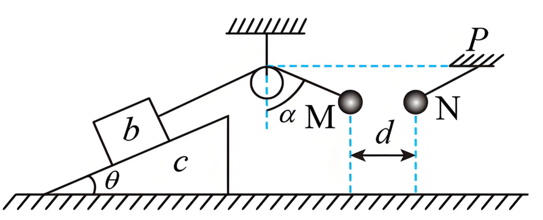

# Physics - 题目 181

**ID**: f8d76af0cd03424cba5377b6922ed8ed
**年级**: Grade 11
**难度**: Medium-Hard
**题型**: Multiple-select

## 题目
如图所示，质量 $m{{}_{{\rm{b}}}}=2{\rm{k}}{\rm{g}}$ 的小物块b置于倾角为 $θ{\rm{=}}{{3}}{{0}}{}\degree $ 的斜面体c上，通过绝缘细绳跨过光滑的定滑轮与带正电荷 $Q{{}_{{\rm{M}}}}=1\times 10{^{-6}}{\rm{C}}$ 的小球M连接，左侧细绳与斜面平行，带负电荷 $Q{{}_{{\rm{N}}}}=-\frac {\sqrt {3}}{2}\times 10{^{-6}}{\rm{C}}$ 的小球N用绝缘细绳悬挂于P点，两小球的质量相等。​​​​​​​‌初始时刻，连接小球M的一段细绳与竖直方向的夹角 $α=60{}\degree $ 且两小球之间的距离d=3cm。设两带电小球在缓慢漏电的过程中，两球心始终处于同一水平面，且b、c都静止，放电结束后滑块b恰好没滑动，最大静摩擦力等于滑动摩擦力。静电力常量 $k=9.0\times 10{^{9}}{\rm{N}}\cdot {\rm{m}}{^{{{2}}}}{\rm{/}}{\rm{C}}{^{{{2}}}}$ 。下列说法正确的是（      ）

## 解答

1. 根据受力分析，可得初始状态，地面对斜面体c的摩擦力大小为 $f=T{\cos}30{^{\circ }}$ ，对小球M受力分析，可得 $T\sin 60{^{\circ }}=F$ ，其中 $F=k\frac {Q{{}_{{\rm{M}}}}Q{{}_{{\rm{N}}}}}{d{^{2}}}=9\times 10{^{9}}\times \frac {10{^{-6}}\times \frac {\sqrt {3}}{2}\times 10{^{-6}}}{{\left({0.03}\right)^{2}}}{\rm{N}}=5\sqrt {3}{\rm{N}}$ ，联立解得 $f=5\sqrt {3}{\rm{N}}{\rm ，A}$ 正确；放电过程中，两小球之间的库仑力F减小，对小球M受力分析得 $F=mg{\tan}α$ ， $T{\cos}α=mg$ ，则随着库仑力F减小，夹角 $α$ 减小，拉力 $T$ 减小。且开始时 $α=60{^{\circ }}$ ，可得M小球的质量为 $m=\frac {F}{g{\tan}60{^{\circ }}}=\frac {5\sqrt {3}}{10\sqrt {3}}{\rm{k}}{\rm{g}}=0.5{\rm{k}}{\rm{g}}$ ，开始时绳子拉力为 $T=\frac {mg}{{\cos}60{^{\circ }}}=10{\rm{N}}$ ，则开始时，对物块b受力分析有 $m{{}_{b}}g\sin θ=T+f{{}_{c}}$ ，可见随着拉力减小，斜面体对物块b的摩擦力一定增大，B错误；设bc整体质量为M，则对bc整体受力分析得 $F{{}_{{\rm{N}}}}+T\sin θ=Mg$ 可见，随着拉力减小，地面对斜面体c的支持力一直变大，C正确；由题意知，放电结束后绳子拉力即为小球M的重力，且滑块b恰好没滑动，则对b受力分析得 $m{{}_{b}}g\sin θ=mg+{\rm μm}{{}_{b}}g{\cos}θ$ ，解得 $μ=\frac {\sqrt {3}}{6}{\rm ，D}$ 错误。

## 知识点

**中文**:
  - 带电体在库仑力作用下的平衡问题

**English**:
  - Equilibrium under Coulomb Force

---
