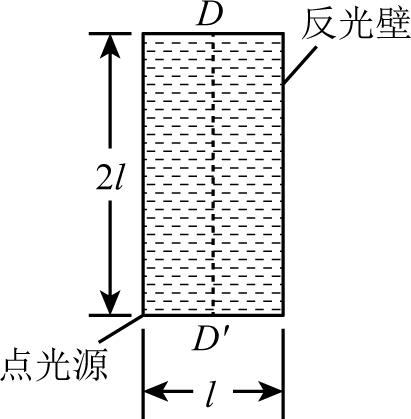

# Physics - 题目 862

**ID**: 4dfc0f9efec8409a8e8a50670ddbe15c
**年级**: Grade 11
**难度**: Medium-Hard
**题型**: 练习

## 题目
一直桶状容器的高为21，底面是边长为l的正方形；容器内装满某种透明液体，过容器中心轴DD′、垂直于左右两侧面的剖面图如图所示。​​​​​​​‌容器右侧内壁涂有反光材料，其他内壁涂有吸光材料。在剖面的左下角处有一点光源，已知由液体上表面的D点射出的两束光线相互垂直，求该液体的折射率。

## 解答

1. 设从光源发出直射到D点的光线的入射角为i_{1}，折射角为r_{1}，在剖面内做光源相对于反光壁的镜像对称点C，连接CD，交反光壁于E点，由光源射向E点的光线，反射后沿ED射向D点；光线在D点的入射角为i_{2}，折射角为r_{2}，如图所示；
2. 
3. 设液体的折射率为n，由折射定律： $n{\rm{s}}{\rm{i}}{\rm{n}}i{{}_{1}}={\rm{s}}{\rm{i}}{\rm{n}}r{{}_{1}}$ ①， $n{\rm{s}}{\rm{i}}{\rm{n}}i{{}_{2}}={\rm{s}}{\rm{i}}{\rm{n}}r{{}_{2}}$ ②，依题意： $r{{}_{1}}+r{{}_{2}}=90{}\degree $ ③，联立①②③解得： $n{^{2}}=\frac {1}{{\rm{s}}{\rm{i}}{\rm{n}}{^{2}}i{{}_{1}}+{\rm{s}}{\rm{i}}{\rm{n}}{^{2}}i{{}_{2}}}$ ④，由几何关系： ${\rm{s}}{\rm{i}}{\rm{n}}i{{}_{1}}=\frac {\frac {l}{2}}{\sqrt {4l{^{2}}+\frac {l{^{2}}}{4}}}=\frac {1}{\sqrt {17}}$ ⑤， ${\rm{s}}{\rm{i}}{\rm{n}}i{{}_{2}}=\frac {\frac {3l}{2}}{\sqrt {4l{^{2}}+\frac {9l{^{2}}}{4}}}=\frac {3}{5}$ ⑥，联立④⑤⑥解得：n=1.55

## 知识点

**中文**:
  - 光的折射定律及其应用

**English**:
  - Law of Refraction and Applications

---
