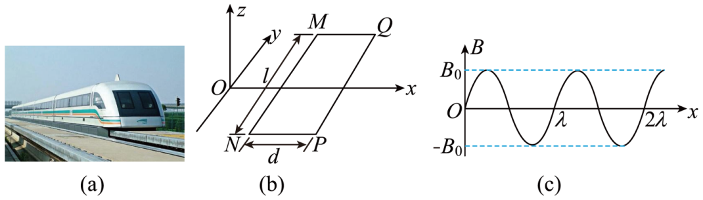

# Physics - 题目 2882

**ID**: 52aed02e2603429f982b74b8c1d72c26
**年级**: Grade 11
**难度**: Medium-Hard
**题型**: 练习

## 题目
磁悬浮列车是一种高速低耗的新型交通工具，如图（a）所示。​​​​​​​‌它的驱动系统可简化为如下模型，固定在列车下端的动力绕组可视为一个矩形金属框，电阻为R的金属框置于xOy平面内，MN长为l平行于y轴，NP宽为d平行于x轴，如图（b）所示。轨道区域内存在垂直于金属框平面的磁场，磁感应强度B沿Ox方向按波长为λ的正弦规律分布，如图（c）所示。整个磁场以一定的速率沿Ox方向匀速平移，忽略一切阻力，列车在驱动系统作用下沿Ox方向加速行驶。（1）简要叙述列车运行中获得驱动力的原理。（2）为使列车获得最大驱动力，MN、PQ边应处于磁场中的什么位置？

## 解答

1. （1）由于列车速度与磁场平移速度不同，导致穿过金属框的磁通量发生变化，由于电磁感应，金属框中会产生感应电流，该电流受到安培力即为驱动力。
2. （2）为使列车获得最大驱动力，NM、PQ应位于磁场中磁感应强度同为最大值且反向的地方，这会使得金属框所围面积的磁通量变化率最大，导致线框中电流最强，也会使得金属框长边中电流受到的安培力最大，因此，d应为 $\frac {λ}{2}$ 的奇数倍，即 $d=(2k+1)\frac {λ}{2}$ 或 $λ=\frac {2d}{2k+1}$ （ $k=0,1,2,3\cdot \cdot \cdot $ ）

## 知识点

**中文**:
  - 电磁感应定律的应用

**English**:
  - Applications of Faraday's Law

---
